

  <picture>
    <source media="(prefers-color-scheme: dark)" srcset="assets/brand/cuteafd-logo-color-dark.svg">
    
  </picture>

CuteAFD brings frontier-scale open-weights models into the home lab at
data-center speed: one or two RTX PRO 6000 cards run attention while a pool of
DGX Sparks serves the routed experts over RoCE.

- **Attention/FFN disaggregation:** RTX cards run attention and the backbone,
  DGX Sparks hold the routed experts, and activations cross RoCE straight into
  GPU memory.
- **Checkpoints as shipped:** official FP8 and MXFP4, NVIDIA NVFP4 and EXL3
  load from the Hugging Face snapshot itself, with no repacking or side files.
- **Exact prefix cache:** agentic sessions restore the deepest cached prefix
  byte-for-byte instead of recomputing it.
- **Built-in dashboard:** a live console of lanes, pipeline stages and draft
  acceptance, plus a benchmark page with speed, quality and agentic panels.
  [Dashboard](docs/dashboard.md)
- **Images and audio:** bundled vision and audio towers run on a Spark or an
  RTX wherever the planner finds room. [Design](docs/multimodal-design.md)
- **Plan before you serve:** `cuteafd plan` names what a checkpoint needs and
  how it fits your cards, and can copy each host only the shards it reads.
  [Sliced checkpoints](docs/sliced-checkpoints.md)
- **Claude Code and Codex on your model:** Anthropic Messages, OpenAI
  Responses and Realtime APIs with server-side web search, so the CLIs connect
  directly. [Client APIs](docs/client-apis.md)
- **Own your intelligence:** your weights, your hardware, no rate limits.

Prefill reports without `prompt_content: "realistic-v1"` used synthetic filler.
New prefill benchmarks use fixed real code, agent/tool transcripts and technical
prose; their prefill numbers are not directly comparable to the older content.
Decode and agentic-session workloads are unchanged.

## What's new in v4.1.0

- **Table look-ahead for DeepSeek V4.1 Engram and Qwen 3.8 PLE:** rows read at
  random every token are fetched ahead of need into a small bounded cache, in
  prefill-unit deadline order, starting when a request is admitted. Decode
  prefetches each round's anchor during the draft phase. The read profile
  follows each file's own placement (local or remote), with no setting.
  V4.1 8K prefill: 10.3k → 11.2k tok/s on 2× RTX + 6 Sparks, 7.0k → 8.2k on
  1× RTX + 3 Sparks.
- **Faster Spark expert prefill:** the warp-specialized EXL3 FC1 rotation is
  chosen per hardware class (hoisted on RTX, in-tile on DGX Spark). GLM 5.3 on
  2× RTX + 6 Sparks: 8K prefill 2.6k → 3.5k tok/s. V4 Pro, GLM 5.3 Flash and
  Kimi K3 gain 5-17%.
- **One coordinator GPU selector for every family:** `COORDINATOR_GPUS` takes
  an ordered pair (primary first) by index, PCI bus id or UUID, DeepSeek V4.1
  included. It replaces the `COORDINATOR_GPU*` keys.
- **RDMA queue pairs bind to the address that routes to each peer**, never to
  the first address in the GID table, so a port shared with a management
  network can't pick the wrong one.

Full notes: [v4.1.0 release](https://github.com/tpurtell/cuteafd/releases/tag/v4.1.0) ·
[all releases](https://github.com/tpurtell/cuteafd/releases)

## Models

One basic-profile card per model and quant on this release: the natural minimum
(1× RTX + the fewest Sparks) or maximum (2× RTX + 4 or 6 Sparks). In the 5090
column, cards labelled "simulated 5090" ran on an RTX PRO 6000 capped at
31.8 GiB (memory only, not SM count or clocks) until real RTX 5090 cards replace
them. Earlier releases and every other
report: [benchmarks](benchmarks/README.md).

V4.1 also supports [StridedPLE](https://huggingface.co/wrldsuksgo2mars/DeepSeek-V4.1-Flash-1017-StridedPLE),
a byte-preserving Engram storage repack of the official 1017 checkpoint
([minimum config](examples/configs/v41-flash-strided-min.config) ·
[maximum config](examples/configs/v41-flash-strided-max.config)).
The official checkpoint remains the default. When serving StridedPLE from
SparkNest, mark its Engram parts `nest passthrough … always`; through the FUSE
daemon, decode loses a few percent per Engram read.

Variant cards outside the table, on the same release:
[V4.1 Flash, 1× RTX + 4 Sparks](benchmarks/deepseek_v41/2026-10-31-smoke-deepseek-v4-1-flash-1017-1rtx-4spark-v41-flash-reference-tp4/card.svg) ·
[V4 Flash, 1× RTX + 4 Sparks](benchmarks/deepseek_v4/2026-10-30-smoke-deepseek-v4-flash-0731-1rtx-4spark-v4-flash-reference-tp4/card.svg) ·
[GLM 5.3 EXLR8 with A8 prefill](benchmarks/glm5/2026-10-30-smoke-glm-5-3-exlr8-k2-k3-k4-2rtx-6spark-glm53-exlr8-a8-max/card.svg) ·
[Qwen 3.8 27B BF16 without MTP](benchmarks/qwen3_5/2026-10-30-smoke-qwen3-8-27b-1rtx-qwen38-27b-bf16-min-nospec/card.svg) ·
[Qwen 3.8 27B FP8 without MTP](benchmarks/qwen3_5/2026-10-30-smoke-qwen3-8-27b-fp8-1rtx-qwen38-27b-fp8-min-nospec/card.svg).
Dense Qwen cards admit 4 concurrent requests (8 for the 9B), so their widest
concurrency point is that limit.

<!-- results:begin -->
<table>
<tr><th>Model · quant</th><th>5090</th><th>1× RTX</th><th>2× RTX</th></tr>
<tr>
<td width="19%" valign="top"><a href="docs/models/deepseek_v41.md"><b>DeepSeek V4.1</b></a> deepseek-ai/DeepSeek-V4.1-Flash-1017 mxfp4-g32</td>
<td width="27%" valign="top"><a href="benchmarks/deepseek_v41/2026-10-31-smoke-deepseek-v4-1-flash-1017-1rtx-3spark-v41-flash-5090/card.svg">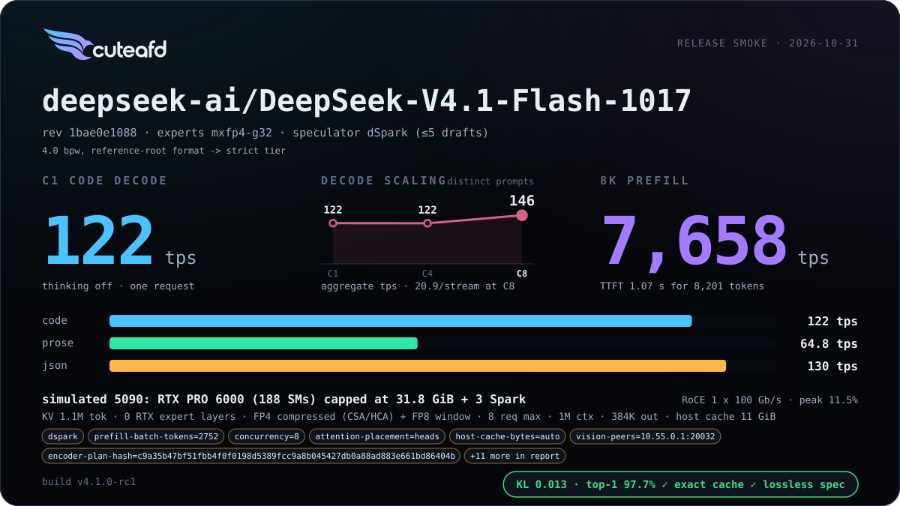</a> simulated 5090 + 3× Spark</td>
<td width="27%" valign="top"> 1× RTX + 3× Spark</td>
<td width="27%" valign="top"><a href="benchmarks/deepseek_v41/2026-10-31-smoke-deepseek-v4-1-flash-1017-2rtx-6spark-v41-flash-max/card.svg">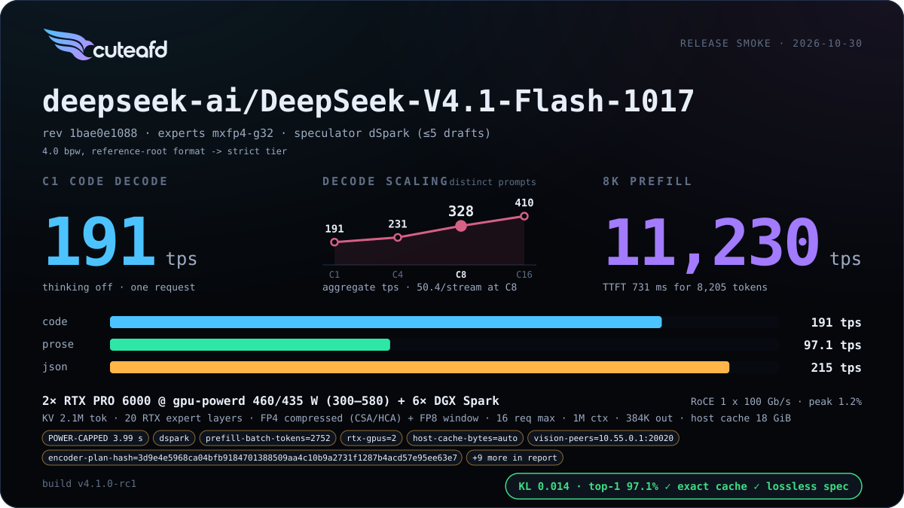</a> 2× RTX + 6× Spark</td>
</tr>
<tr>
<td width="19%" valign="top"><a href="docs/models/deepseek_v41.md"><b>DeepSeek V4.1</b></a> wrldsuksgo2mars/DeepSeek-V4.1-Flash-1017-StridedPLE mxfp4-g32</td>
<td width="27%" valign="top">n/a —</td>
<td width="27%" valign="top"> 1× RTX + 3× Spark</td>
<td width="27%" valign="top"><a href="benchmarks/deepseek_v41/2026-10-31-smoke-deepseek-v4-1-flash-1017-stridedple-2rtx-6spark-v41-flash-strided-max/card.svg">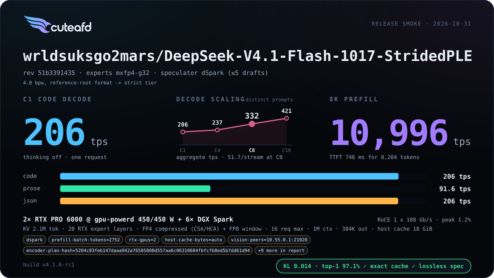</a> 2× RTX + 6× Spark</td>
</tr>
<tr>
<td width="19%" valign="top"><a href="docs/models/deepseek_v4.md"><b>DeepSeek V4</b></a> deepseek-ai/DeepSeek-V4-Flash-0731 mxfp4-g32</td>
<td width="27%" valign="top"><a href="benchmarks/deepseek_v4/2026-10-30-smoke-deepseek-v4-flash-0731-1rtx-2spark-v4-flash-5090/card.svg">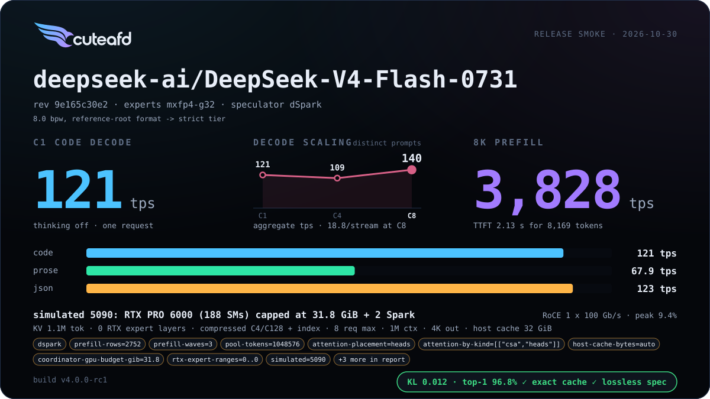</a> simulated 5090 + 2× Spark</td>
<td width="27%" valign="top"><a href="benchmarks/deepseek_v4/2026-10-30-smoke-deepseek-v4-flash-0731-1rtx-2spark-v4-flash-min/card.svg">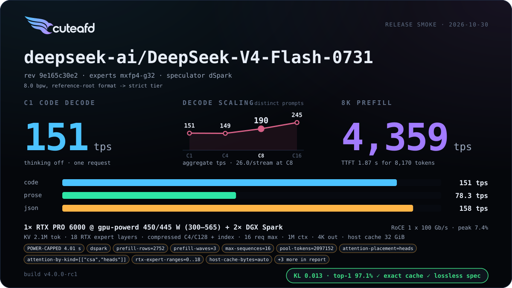</a> 1× RTX + 2× Spark</td>
<td width="27%" valign="top">n/a —</td>
</tr>
<tr>
<td width="19%" valign="top"><a href="docs/models/deepseek_v4.md"><b>DeepSeek V4</b></a> wrldsuksgo2mars/DeepSeek-V4-Pro-0813-EXL3-K2-calibrated-v1 exl3-k2</td>
<td width="27%" valign="top">n/a doesn&#39;t fit</td>
<td width="27%" valign="top">n/a —</td>
<td width="27%" valign="top"><a href="benchmarks/deepseek_v4/2026-10-31-smoke-deepseek-v4-pro-0813-exl3-k2-calibrated-v1-2rtx-6spark-v4-pro-exl3-max/card.svg">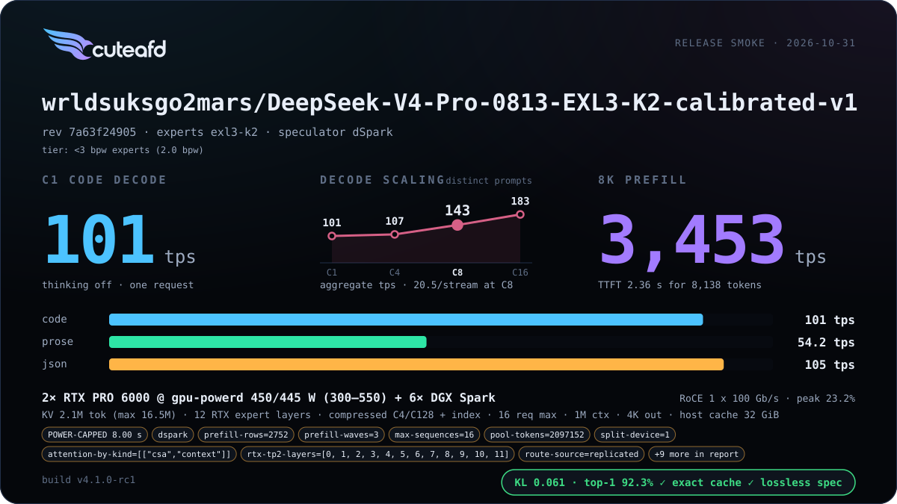</a> 2× RTX + 6× Spark</td>
</tr>
<tr>
<td width="19%" valign="top"><a href="docs/models/kimi_k3.md"><b>Kimi K3</b></a> wrldsuksgo2mars/Kimi-K3-EXL3-K2-Core-K6 exl3-k2</td>
<td width="27%" valign="top">n/a doesn&#39;t fit</td>
<td width="27%" valign="top">n/a —</td>
<td width="27%" valign="top"> 2× RTX + 6× Spark</td>
</tr>
<tr>
<td width="19%" valign="top"><a href="docs/models/glm5.md"><b>GLM 5.3</b></a> wrldsuksgo2mars/GLM-5.3-EXL3-K4-v1 exl3-k4</td>
<td width="27%" valign="top">n/a doesn&#39;t fit</td>
<td width="27%" valign="top"> 1× RTX + 4× Spark</td>
<td width="27%" valign="top"> 2× RTX + 6× Spark</td>
</tr>
<tr>
<td width="19%" valign="top"><a href="docs/models/glm5.md"><b>GLM 5.3</b></a> wrldsuksgo2mars/GLM-5.3-EXL3-K4-Core-K6 exl3-k4</td>
<td width="27%" valign="top">n/a doesn&#39;t fit</td>
<td width="27%" valign="top"> 1× RTX + 4× Spark</td>
<td width="27%" valign="top"> 2× RTX + 6× Spark</td>
</tr>
<tr>
<td width="19%" valign="top"><a href="docs/models/glm5.md"><b>GLM 5.3</b></a> nvidia/GLM-5.3-NVFP4 nvfp4-g16</td>
<td width="27%" valign="top">n/a doesn&#39;t fit</td>
<td width="27%" valign="top"> 1× RTX + 4× Spark</td>
<td width="27%" valign="top">n/a —</td>
</tr>
<tr>
<td width="19%" valign="top"><a href="docs/models/glm5.md"><b>GLM 5.3</b></a> kindlingai/glm-5.3-exlr8-k2-k3-k4 </td>
<td width="27%" valign="top">n/a doesn&#39;t fit</td>
<td width="27%" valign="top"> 1× RTX + 4× Spark</td>
<td width="27%" valign="top"> 2× RTX + 6× Spark</td>
</tr>
<tr>
<td width="19%" valign="top"><a href="docs/models/glm5_flash.md"><b>GLM 5.3 Flash</b></a> wrldsuksgo2mars/GLM-5.3-Flash-EXL3-K3.25-Core-FP8 exl3-k3+exl3-k4</td>
<td width="27%" valign="top"><a href="benchmarks/glm5_flash/2026-10-31-smoke-glm-5-3-flash-exl3-k3-25-core-fp8-1rtx-2spark-glm53f-exl3-5090/card.svg">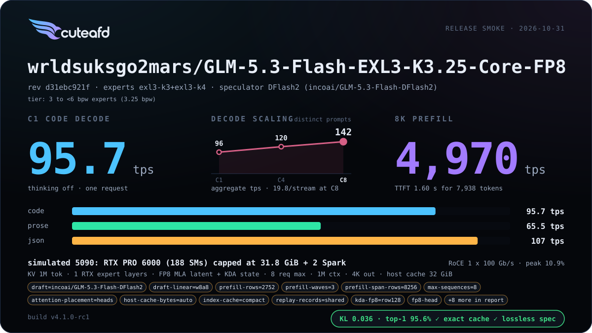</a> simulated 5090 + 2× Spark</td>
<td width="27%" valign="top"><a href="benchmarks/glm5_flash/2026-10-31-smoke-glm-5-3-flash-exl3-k3-25-core-fp8-1rtx-2spark-glm53f-exl3-min/card.svg">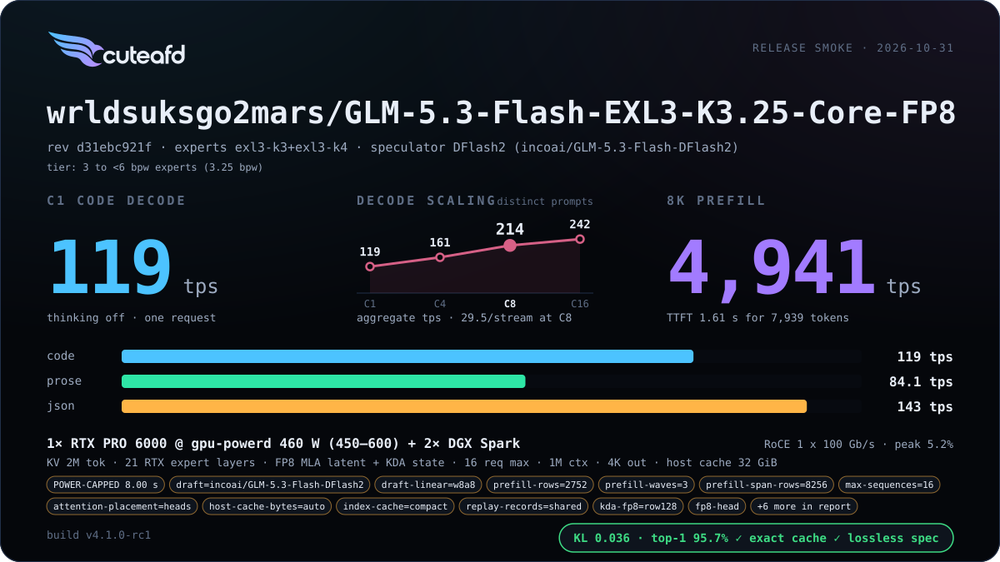</a> 1× RTX + 2× Spark</td>
<td width="27%" valign="top"><a href="benchmarks/glm5_flash/2026-10-30-smoke-glm-5-3-flash-exl3-k3-25-core-fp8-2rtx-glm53f-exl3-max/card.svg">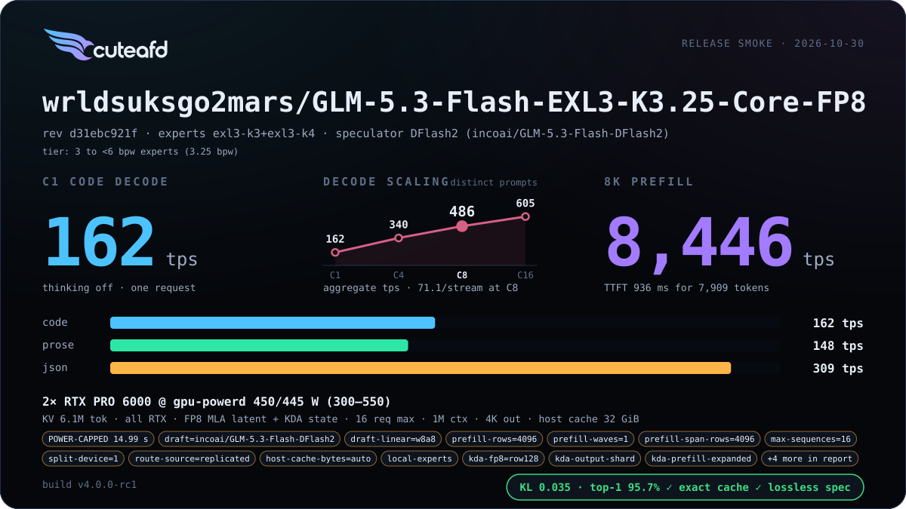</a> 2× RTX</td>
</tr>
<tr>
<td width="19%" valign="top"><a href="docs/models/glm5_flash.md"><b>GLM 5.3 Flash</b></a> wrldsuksgo2mars/GLM-5.3-Flash-EXL3-K4-Core-K6 exl3-k4</td>
<td width="27%" valign="top">n/a —</td>
<td width="27%" valign="top"><a href="benchmarks/glm5_flash/2026-10-31-smoke-glm-5-3-flash-exl3-k4-core-k6-1rtx-2spark-glm53f-exl3-k6-min/card.svg">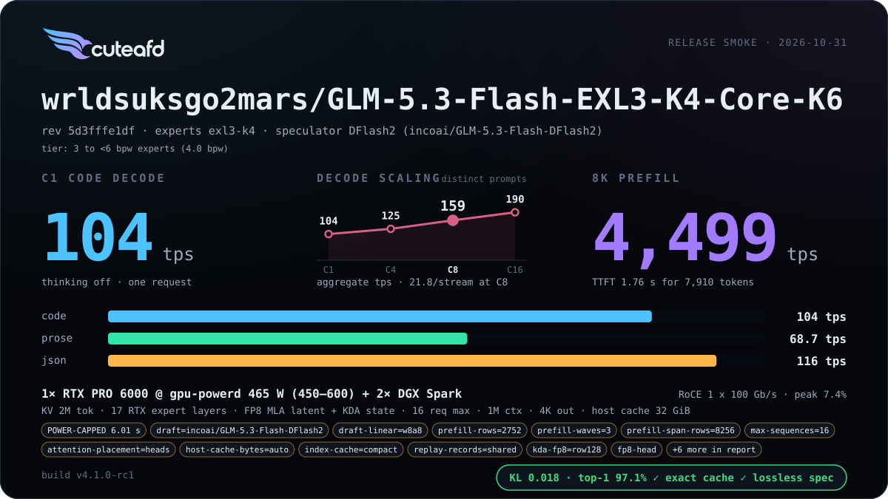</a> 1× RTX + 2× Spark</td>
<td width="27%" valign="top"><a href="benchmarks/glm5_flash/2026-10-30-smoke-glm-5-3-flash-exl3-k4-core-k6-2rtx-glm53f-exl3-k6-max/card.svg">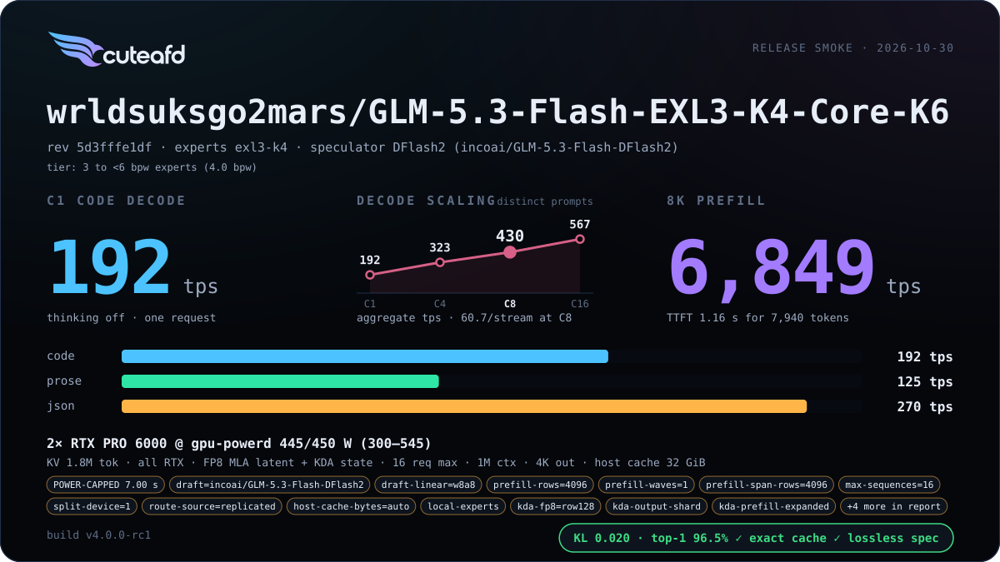</a> 2× RTX</td>
</tr>
<tr>
<td width="19%" valign="top"><a href="docs/models/glm5_flash.md"><b>GLM 5.3 Flash</b></a> nvidia/GLM-5.3-Flash-NVFP4 nvfp4-g16</td>
<td width="27%" valign="top"><a href="benchmarks/glm5_flash/2026-10-30-smoke-glm-5-3-flash-nvfp4-1rtx-2spark-glm53f-nvfp4-5090/card.svg">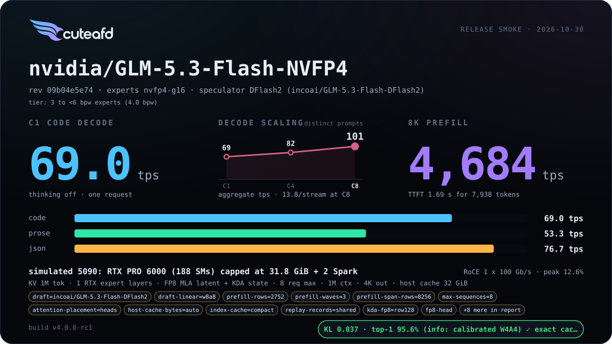</a> simulated 5090 + 2× Spark</td>
<td width="27%" valign="top"><a href="benchmarks/glm5_flash/2026-10-30-smoke-glm-5-3-flash-nvfp4-1rtx-2spark-glm53f-nvfp4-min/card.svg">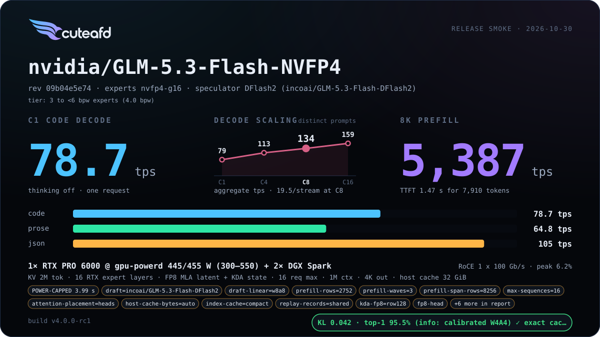</a> 1× RTX + 2× Spark</td>
<td width="27%" valign="top">n/a —</td>
</tr>
<tr>
<td width="19%" valign="top"><a href="docs/models/glm5_flash.md"><b>GLM 5.3 Flash</b></a> brandonmusic/GLM-5.3-Flash-tr3-4bpw exl3-k4</td>
<td width="27%" valign="top"><a href="benchmarks/glm5_flash/2026-10-31-smoke-glm-5-3-flash-tr3-4bpw-1rtx-2spark-glm53f-tr3-5090/card.svg">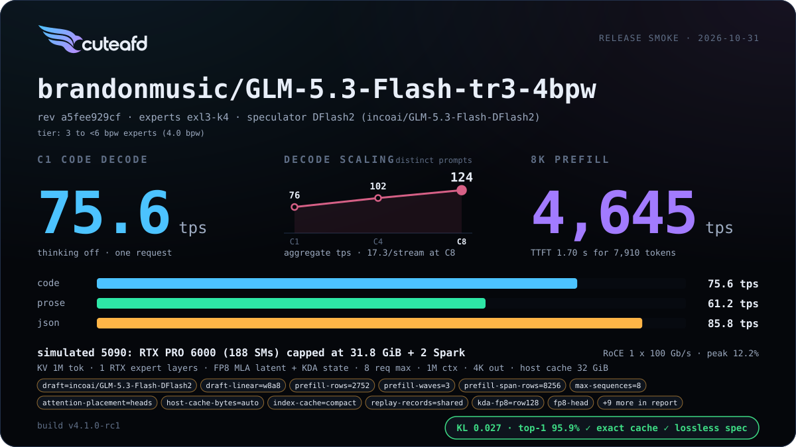</a> simulated 5090 + 2× Spark</td>
<td width="27%" valign="top"><a href="benchmarks/glm5_flash/2026-10-31-smoke-glm-5-3-flash-tr3-4bpw-1rtx-2spark-glm53f-tr3-min/card.svg">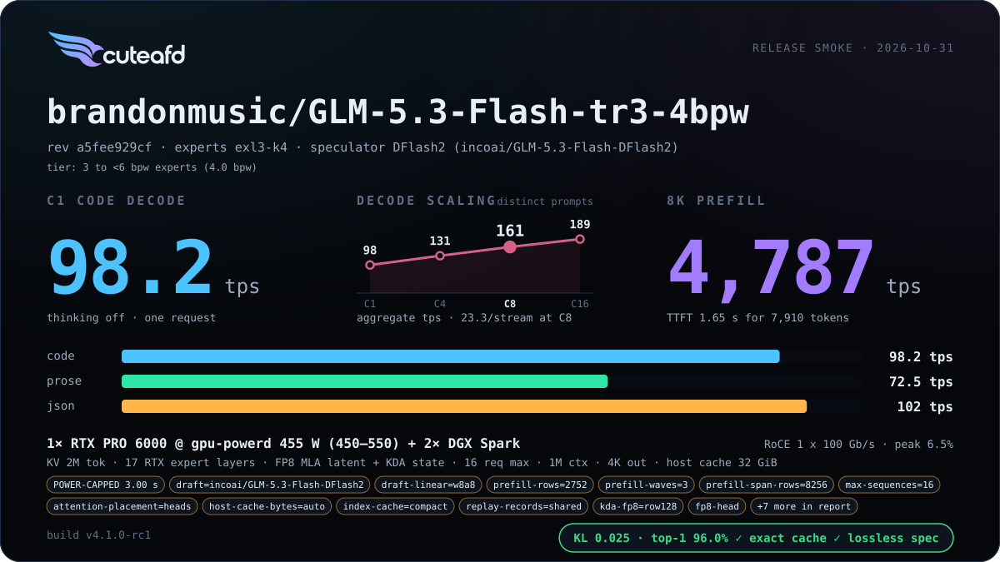</a> 1× RTX + 2× Spark</td>
<td width="27%" valign="top">n/a —</td>
</tr>
<tr>
<td width="19%" valign="top"><a href="docs/models/mimo_v2.md"><b>MiMo V2</b></a> XiaomiMiMo/MiMo-V2.6-Flash-MOPD mxfp4-g32</td>
<td width="27%" valign="top"><a href="benchmarks/mimo_v2/2026-10-30-smoke-mimo-v2-6-flash-mopd-1rtx-2spark-mimo26-flash-5090/card.svg">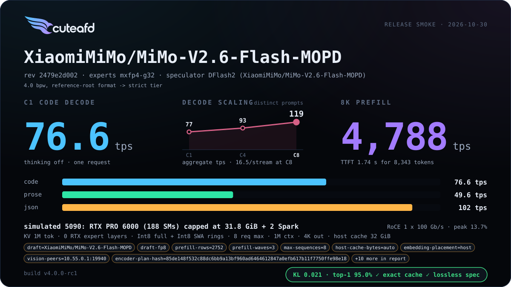</a> simulated 5090 + 2× Spark</td>
<td width="27%" valign="top"><a href="benchmarks/mimo_v2/2026-10-30-smoke-mimo-v2-6-flash-mopd-1rtx-2spark-mimo26-flash-min/card.svg">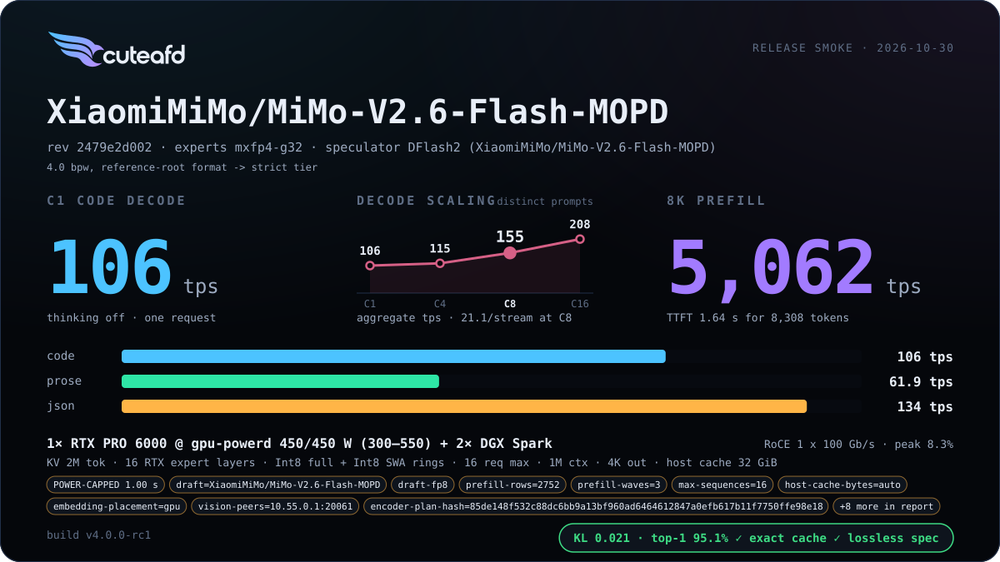</a> 1× RTX + 2× Spark</td>
<td width="27%" valign="top">n/a —</td>
</tr>
<tr>
<td width="19%" valign="top"><a href="docs/models/mimo_v2.md"><b>MiMo V2</b></a> XiaomiMiMo/MiMo-V2.6-Pro-MOPD mxfp4-g32</td>
<td width="27%" valign="top">n/a doesn&#39;t fit</td>
<td width="27%" valign="top">n/a —</td>
<td width="27%" valign="top"><a href="benchmarks/mimo_v2/2026-10-30-smoke-mimo-v2-6-pro-mopd-2rtx-6spark-mimo-pro-max/card.svg">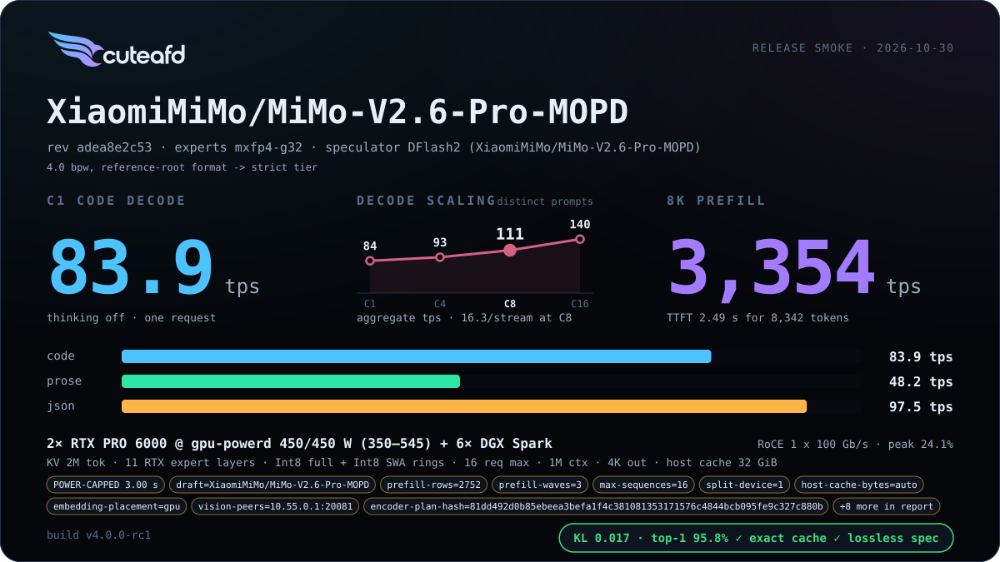</a> 2× RTX + 6× Spark</td>
</tr>
<tr>
<td width="19%" valign="top"><a href="docs/models/step5.md"><b>Step-5</b></a> stepfun-ai/Step-5-Preview bf16+fp8-tensor/f32</td>
<td width="27%" valign="top">n/a doesn&#39;t fit</td>
<td width="27%" valign="top">n/a —</td>
<td width="27%" valign="top"><a href="benchmarks/step5/2026-10-30-smoke-step-5-preview-2rtx-6spark-step5-fp8-max/card.svg">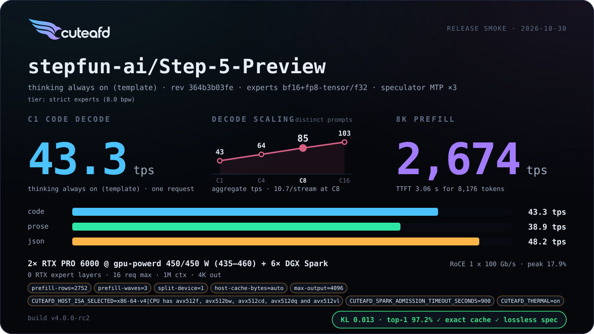</a> 2× RTX + 6× Spark</td>
</tr>
<tr>
<td width="19%" valign="top"><a href="docs/models/step5.md"><b>Step-5</b></a> stepfun-ai/Step-5-Preview-NVFP4 bf16+nvfp4-g16</td>
<td width="27%" valign="top">n/a doesn&#39;t fit</td>
<td width="27%" valign="top"><a href="benchmarks/step5/2026-10-30-smoke-step-5-preview-nvfp4-1rtx-4spark-step5-nvfp4-min/card.svg">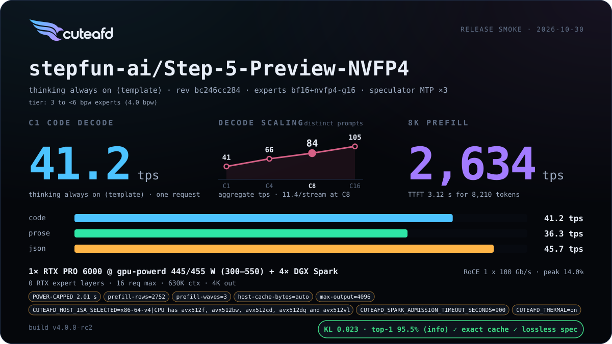</a> 1× RTX + 4× Spark</td>
<td width="27%" valign="top">n/a —</td>
</tr>
<tr>
<td width="19%" valign="top"><a href="docs/models/qwen4.md"><b>Qwen 3.8</b></a> wrldsuksgo2mars/Qwen3.8-Flash-Next-EXL3-K4.25-PLE-FP8-v1 exl3-k4+exl3-k5</td>
<td width="27%" valign="top"><a href="benchmarks/qwen4/2026-10-31-smoke-qwen3-8-flash-next-exl3-k4-25-ple-fp8-v1-1rtx-1spark-qwen38-exl3-5090/card.svg">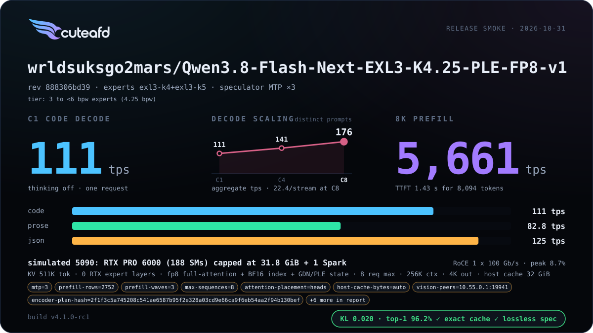</a> simulated 5090 + 1× Spark</td>
<td width="27%" valign="top"><a href="benchmarks/qwen4/2026-10-31-smoke-qwen3-8-flash-next-exl3-k4-25-ple-fp8-v1-1rtx-qwen38-exl3-min/card.svg">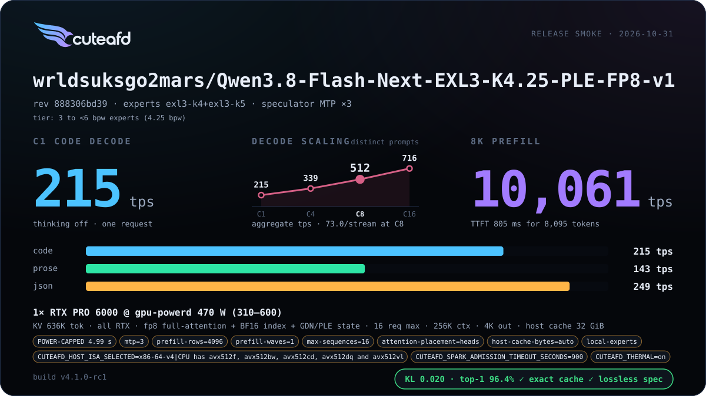</a> 1× RTX</td>
<td width="27%" valign="top">n/a —</td>
</tr>
<tr>
<td width="19%" valign="top"><a href="docs/models/qwen3_5.md"><b>Qwen 3.5 / 3.8 dense</b></a> Qwen/Qwen3.5-9B </td>
<td width="27%" valign="top">n/a —</td>
<td width="27%" valign="top"><a href="benchmarks/qwen3_5/2026-10-30-smoke-qwen3-5-9b-1rtx-qwen35-9b-bf16-min/card.svg">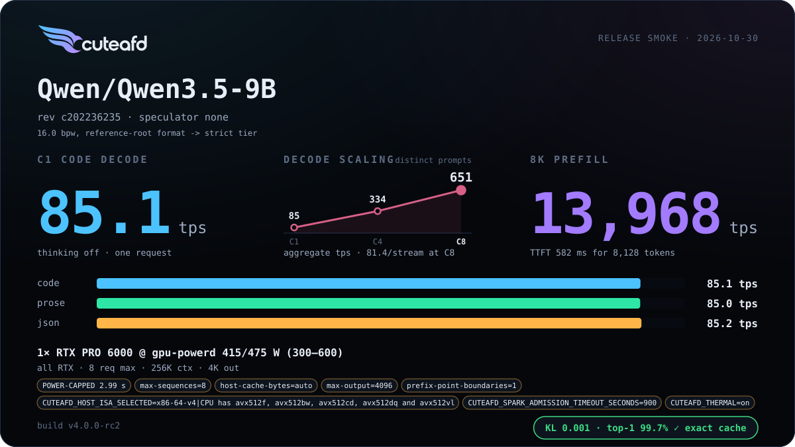</a> 1× RTX</td>
<td width="27%" valign="top">n/a —</td>
</tr>
<tr>
<td width="19%" valign="top"><a href="docs/models/qwen3_5.md"><b>Qwen 3.5 / 3.8 dense</b></a> Qwen/Qwen3.8-27B </td>
<td width="27%" valign="top">n/a —</td>
<td width="27%" valign="top"><a href="benchmarks/qwen3_5/2026-10-30-smoke-qwen3-8-27b-1rtx-qwen38-27b-bf16-min/card.svg">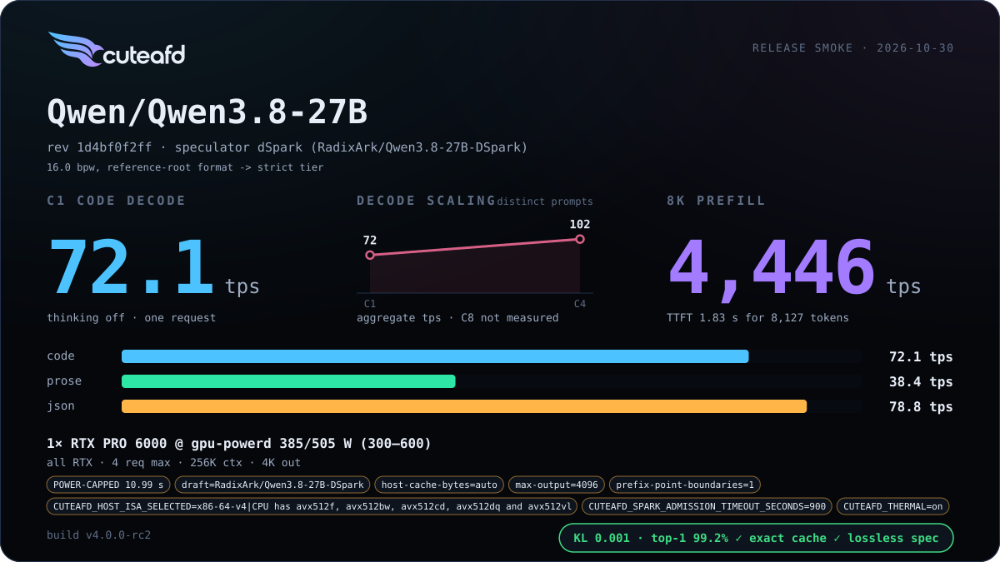</a> 1× RTX</td>
<td width="27%" valign="top">n/a —</td>
</tr>
<tr>
<td width="19%" valign="top"><a href="docs/models/qwen3_5.md"><b>Qwen 3.5 / 3.8 dense</b></a> Qwen/Qwen3.8-27B-FP8 </td>
<td width="27%" valign="top">n/a —</td>
<td width="27%" valign="top"><a href="benchmarks/qwen3_5/2026-10-30-smoke-qwen3-8-27b-fp8-1rtx-qwen38-27b-fp8-min/card.svg">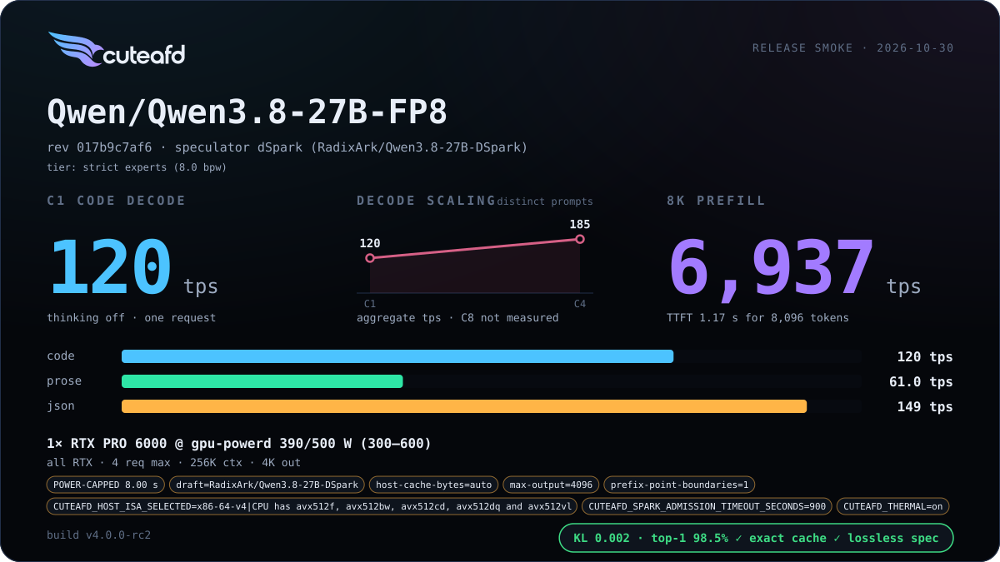</a> 1× RTX</td>
<td width="27%" valign="top">n/a —</td>
</tr>
</table>

Each card is one launch of the basic profile: tok/s for C1 decode and concurrent decode with thinking off (each stream its own prompt; earlier cards sent one code prompt to every stream, which shares experts and drafts and reads higher), cold 8K prefill, logit fidelity against the family golden reference, prefix-cache restore exactness and lossless speculation. Older releases, other profiles and every report: [benchmarks](benchmarks/README.md).

### Retired

Last Release-smoke cards for retired configurations; no new measurements. Version labels identify the actual tagged or development build recorded by each report; hover for provenance.

<table>
<tr><th>Model</th><th>Config</th><th>Version</th><th>Last card</th></tr>
<tr><td>nvidia/GLM-5.3-NVFP4</td><td><a href="examples/configs/glm53-nvfp4-max.config">glm53-nvfp4-max</a> 2× RTX + 6× Spark</td><td title="build 78d27e34a349; commit 78d27e34a349beb3d9e8935d3fbc55a766f432e2; Untagged v3 development build; date is the smoke report date.">v3 dev 2026-10-15</td><td></td></tr>
<tr><td>nvidia/GLM-5.3-Flash-NVFP4</td><td><a href="examples/configs/glm53-flash-nvfp4-max.config">glm53f-nvfp4-max</a> 2× RTX + 2× Spark</td><td title="build 92ad5b03d029; commit 92ad5b03d0299a72eb2bbab1adf30387ec81f003; Untagged v3 development build; date is the smoke report date.">v3 dev 2026-10-14</td><td></td></tr>
<tr><td>brandonmusic/GLM-5.3-Flash-tr3-4bpw</td><td><a href="examples/configs/glm53-flash-tr3-max.config">glm53f-tr3-max</a> 2× RTX + 2× Spark</td><td title="build 92ad5b03d029; commit 92ad5b03d0299a72eb2bbab1adf30387ec81f003; Untagged v3 development build; date is the smoke report date.">v3 dev 2026-10-14</td><td></td></tr>
<tr><td>XiaomiMiMo/MiMo-V2.6-Pro-MOPD</td><td><a href="examples/configs/mimo-v26-pro-mxfp4-min.config">mimo-pro-min</a> 1× RTX + 6× Spark</td><td title="build 92ad5b03d029; commit 92ad5b03d0299a72eb2bbab1adf30387ec81f003; Untagged v3 development build; date is the smoke report date.">v3 dev 2026-10-14</td><td></td></tr>
<tr><td>XiaomiMiMo/MiMo-V2.6-Flash-MOPD</td><td><a href="examples/configs/mimo-v26-flash-mxfp4-max.config">mimo26-flash-max</a> 2× RTX + 4× Spark</td><td title="build 92ad5b03d029; commit 92ad5b03d0299a72eb2bbab1adf30387ec81f003; Untagged v3 development build; date is the smoke report date.">v3 dev 2026-10-14</td><td></td></tr>
<tr><td>wrldsuksgo2mars/Qwen3.8-Flash-Next-EXL3-K4.25-PLE-FP8-v1</td><td><a href="examples/configs/qwen38-exl3-min.config">qwen38-exl3-max</a> 2× RTX</td><td title="build 92ad5b03d029; commit 92ad5b03d0299a72eb2bbab1adf30387ec81f003; Untagged v3 development build; date is the smoke report date.">v3 dev 2026-10-14</td><td></td></tr>
<tr><td>nvidia/Qwen3.8-Flash-Next-NVFP4</td><td><a href="examples/configs/qwen38-nvfp4-min.config">qwen38-nvfp4-max</a> 2× RTX</td><td title="build 92ad5b03d029; commit 92ad5b03d0299a72eb2bbab1adf30387ec81f003; Untagged v3 development build; date is the smoke report date.">v3 dev 2026-10-14</td><td></td></tr>
<tr><td>deepseek-ai/DeepSeek-V4-Flash-0731</td><td><a href="examples/configs/deepseek-v4-flash-mxfp4-max.config">v4-flash-max</a> 2× RTX + 4× Spark</td><td title="build 92ad5b03d029; commit 92ad5b03d0299a72eb2bbab1adf30387ec81f003; Untagged v3 development build; date is the smoke report date.">v3 dev 2026-10-14</td><td></td></tr>
<tr><td>wrldsuksgo2mars/DeepSeek-V4-Pro-0813-EXL3-K2-calibrated-v1</td><td><a href="examples/configs/deepseek-v4-pro-exl3-min.config">v4-pro-exl3-min</a> 1× RTX + 4× Spark</td><td title="build 92ad5b03d029; commit 92ad5b03d0299a72eb2bbab1adf30387ec81f003; Untagged v3 development build; date is the smoke report date.">v3 dev 2026-10-14</td><td></td></tr>
<tr><td>zai-org/GLM-5.3-Flash</td><td><a href="examples/configs/glm53-flash-fp8-min.config">glm53f-fp8-min</a> 1× RTX + 4× Spark</td><td title="build 92ad5b03d029; commit 92ad5b03d0299a72eb2bbab1adf30387ec81f003; Untagged v3 development build; date is the smoke report date.">v3 dev 2026-10-14</td><td></td></tr>
<tr><td>zai-org/GLM-5.3-Flash</td><td><a href="examples/configs/glm53-flash-fp8-max.config">glm53f-fp8-max</a> 2× RTX + 4× Spark</td><td title="build 92ad5b03d029; commit 92ad5b03d0299a72eb2bbab1adf30387ec81f003; Untagged v3 development build; date is the smoke report date.">v3 dev 2026-10-14</td><td></td></tr>
<tr><td>nvidia/Qwen3.8-Flash-Next-NVFP4</td><td><a href="examples/configs/qwen38-nvfp4-min.config">qwen38-nvfp4-min</a> 1× RTX + 2× Spark</td><td title="build v3.0.0-rc5; commit 9f53cc6cc0f3ff56de7cb81d587b3fad77137f4c; Tagged build recorded by the report.">v3.0.0-rc5</td><td></td></tr>
<tr><td>nvidia/Qwen3.8-Flash-Next-NVFP4</td><td><a href="examples/configs/qwen38-nvfp4-min.config">qwen38-nvfp4-5090</a> simulated 5090 + 2× Spark</td><td title="build v3.0.0-rc4; commit 20082ee7f90395dfd4b6a3f4777f51b081b71db8; Tagged build recorded by the report.">v3.0.0-rc4</td><td></td></tr>
<tr><td>wrldsuksgo2mars/GLM-5.3-Flash-EXL3-K3.25-v1</td><td><a href="examples/configs/glm53-flash-exl3-min.config">glm53f-exl3-v1</a> simulated 5090 + 2× Spark</td><td title="build v3.0.0-rc5; commit 9f53cc6cc0f3ff56de7cb81d587b3fad77137f4c; Tagged build recorded by the report.">v3.0.0-rc5</td><td></td></tr>
</table>

<!-- results:end -->

### Known limits

- **Calibrated NVFP4 quants** (GLM 5.3, GLM 5.3 Flash, Qwen 3.8) report
  fidelity as informational: W4A4 is the checkpoint's own calibrated numerics.
- **Qwen 1× RTX** default cells are text-only. A fixed 262,144-token pool turns
  vision on for EXL3. [Details](docs/models/qwen4.md#known-limits)
- **GLM Flash tr3** vision needs `CHAT_TEMPLATE_FROM=zai-org/GLM-5.3-Flash`;
  without it `VISION=auto` serves text only and says so.
- **GLM 5.3 EXLR8** (work/p0 only, not in a release): with multi-lane prefill,
  prompts beyond about 8K tokens can hang at the coordinator's peer wait
  ([#408](https://github.com/tpurtell/cuteafd/issues/408)). Use
  `CUTEAFD_GLM_PREFILL_LANES=1` in the launch environment for long prompts
  until the fix lands.

### Methodology

Cards measure text C1, warmed C8 aggregate code throughput, cold ~8K prefill,
quick fidelity against the family golden reference and exact prefix-cache
restore. They are single launches: compare releases only with matched-prompt
runs. Simulated 5090 cells cap memory only; SM count, L2, clocks and power are
not emulated, so their speed is indicative and likely optimistic.
[How releases are measured](docs/release-testing.md) ·
[all reports](benchmarks/README.md)

Family pages hold supported checkpoints, engineering notes and known limits:
[DeepSeek V4.1 Flash](docs/models/deepseek_v41.md),
[DeepSeek V4 Flash/Pro](docs/models/deepseek_v4.md),
[GLM 5.3](docs/models/glm5.md), [GLM 5.3 Flash](docs/models/glm5_flash.md),
[MiMo V2 Flash / V2.6 Pro](docs/models/mimo_v2.md),
[Qwen 3.8 Flash Next](docs/models/qwen4.md).

## Storage

The checkpoints behind these numbers were served from
[SparkNest](https://github.com/tpurtell/sparknest), a distributed model store
across the cluster: hosts with a sealed local copy of a shard read it at NVMe
speed, others stream it over RoCE at about 5 GB/s. It is a separate project and
not required; any standard Hugging Face cache layout works.

## Host and fabric tuning

Optional; the same run commands work tuned or not, tuning just makes it faster.
Run as root on each host (`--role coordinator` on the RTX host, `--role
spark` on each Spark); every step has `--dry-run`.

| Step | Command | What it does |
|---|---|---|
| Host | `scripts/host/tune.sh apply` | Performance governor, shallow CPU idle only, swap off, no proactive compaction, BBR and large TCP buffers. `tune.sh persist` prints a boot unit. |
| Tools | `scripts/host/tune.sh fabric-lossless tools` | Adds NVIDIA's signed DOCA apt repo, pinned so only `mlnx-tools` (`mlnx_qos`) installs from it. |
| NICs | `scripts/host/tune.sh fabric-lossless apply` | ConnectX: DSCP trust, DSCP 26 (RoCE) → priority 3 with PFC and its own buffer, CNP DSCP 48 → priority 6, global pause off. Saves the original state first. |
| Switch | `/import` [`mikrotik-crs8xx-roce-lossless.rsc`](scripts/fabric/mikrotik-crs8xx-roce-lossless.rsc) | MikroTik CRS8xx: lossless RoCE class 3, strict CNP class 6, DSCP trust on the fabric ports; everything else stays lossy. Edit the port list for your cabling. |

`fabric-lossless check` shows the NIC state, and `rollback` (plus
[`mikrotik-crs8xx-roce-rollback.rsc`](scripts/fabric/mikrotik-crs8xx-roce-rollback.rsc))
restores the saved originals. Details: [Host tuning](docs/host-tuning.md).

## Quick start

1. `cuteafd plan MODEL` (any Hugging Face model id or local snapshot
   directory) reports what the checkpoint needs — tensors, formats, shapes,
   and which kernels are missing — before you touch a GPU. Add `--layout
   --rtx 1|2 --pool-tokens 0` for per-device weights, cache admission,
   workspaces and Spark ranks. `--coordinator-gpu-budget-gib 31.8` sets the
   logical per-GPU ceiling for plan, serve and golden (plan defaults to 95.5
   GiB). Plan's separate `--coordinator-weight-budget-gib` caps only weights
   (default 80 GiB). The old `--rtx-budget-gib`, `--rtx-gib` and
   `--coordinator-budget-gib` spellings remain deprecated aliases.
   V4 Flash/Pro workspace formulas use the
   matching image manifest (`--workspace-manifest PROGRAMS.json`). The
   image also supplies EXL3 allocation manifests; when exporting metadata,
   keep their `exl3/` tree alongside `PROGRAMS.json`.
   V4 Flash native TP2, V4.1 native TP4 and Qwen local EXL3 K4.25 layouts are
   calibrated on one RTX PRO 6000 after 8K prefill and C4; unmeasured layouts
   stay estimates. Offline auto can differ slightly from runtime admission,
   which samples concrete CUDA owners before allocating the pool.
2. Pick or adapt a config under [`examples/configs/`](examples/configs/) or
   edit `cuteafd.config` for your own topology (coordinator GPUs, Spark
   ranks, TP/EP layout). `POOL_TOKENS=auto` selects planner admission for
   V4, V4.1 and Qwen; the engine spelling is `--pool-tokens 0`. V4.1 keeps
   its existing pool policy when this option is omitted.
3. `./run.sh` launches the release images named in the config,
   `ghcr.io/tpurtell/cuteafd-coordinator:v3.0.0` on the RTX host and
   `ghcr.io/tpurtell/cuteafd-spark-expert:v3.0.0` on each Spark; `docker pull`
   them on those hosts first (`./run.sh` does not pull). `./wip.sh --slot S --role both`
   plus `./run.sh --wip S --restart` is the faster loop while iterating.

V4.1 defaults to `CUTEAFD_V41_FP8_HEAD=all`: one E4M3 vocabulary head
(or one shard per GPU) shared by target and dSpark, with BF16 released after
packing. `off` selects BF16; experimental `draft` retains BF16 for the target
and adds FP8 for dSpark. The accepted target-head quality gate and matched RC2
controls support the release default.

## Working on it

[`AGENTS.md`](AGENTS.md) is the standing guide for agents and collaborators
working on CuteAFD. [`PLAN.md`](PLAN.md) is the roadmap.
[WIP hardware cards](docs/wip-cards.md) runs candidate builds through the
release card matrix. [Usage history and console access](docs/usage-and-console-access.md)
covers request accounting, the `/usage` dashboard and the console unlock secret.
**The full request log is on by default: prompts, model outputs and media are
stored in plain text on the serving host for 24 hours** (turn it off on
`/usage` settings or with `USAGE=off`).

## Building from source

Initialize the pinned submodules with `git submodule update --init --recursive`.
The shared toolchain image is published as `ghcr.io/tpurtell/cuteafd-dev` for
amd64 and arm64: choose an immutable `tc-<hash>` tag (or digest) for repeatable
builds; `latest` follows dev toolchain updates. Set `COORDINATOR_DOCKER_DEV` and
`SPARK_EXPERT_DOCKER_DEV` in your config to that reference. WIP and release builds
pull registry references when absent; local image names remain the default.

The image contains no SparkInfer: consumers verify the checkout's tree lock
and import its mounted submodule. A kernel pin change does not require rebuilding
the toolchain. Rebuild with `scripts/build/build-dev-images.sh --dry-run` first,
then without `--dry-run`; `--publish --spark-hosts rhea` publishes only the dev
package and preserves existing local campaign tags. Serialize actual builds
with `~/.cache/cuteafd/build.lock` and the Spark build host's lock.

Compiler caches are off by default. `CUTEAFD_KACHE=1` uses the image's kache for
C/C++ and Rust; `CUTEAFD_KACHE_SPARK=1` enables it on Spark builds.
`CUTEAFD_SCCACHE_CUDA=1` independently selects sccache for CUDA. Cache directories
are host NVMe bind mounts under `~/.cache/cuteafd/builds/compiler-cache`, not
image layers. Read-only source/JIT smoke: run
`scripts/build/smoke-b12x-readonly.py --source /source --jit` inside a matching
architecture's dev container with `/source:ro`, writable `HOME` and cache roots,
and NVIDIA driver libraries (no GPU device is needed).
