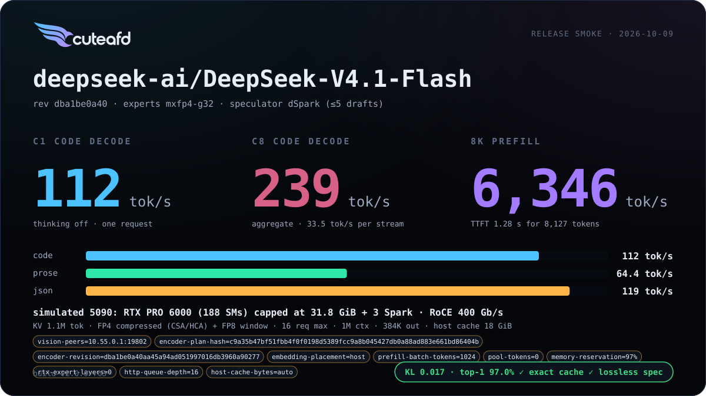
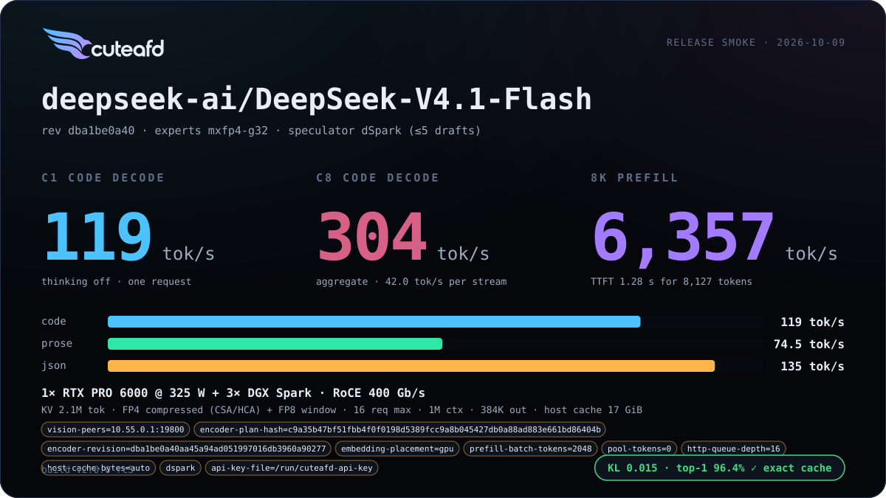
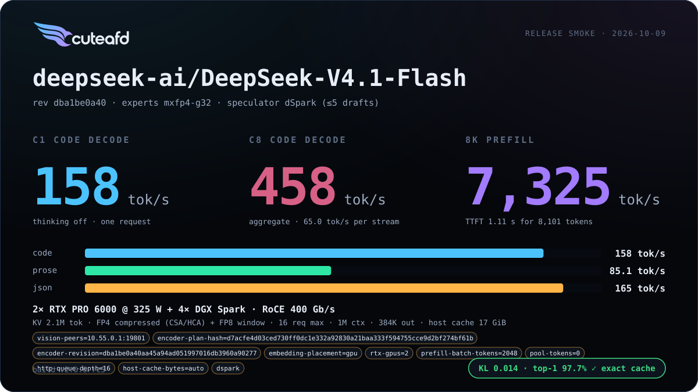
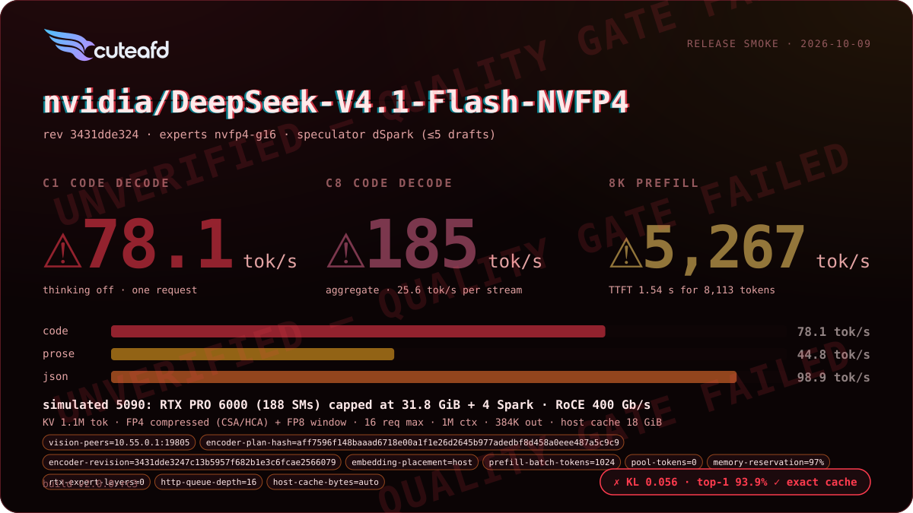
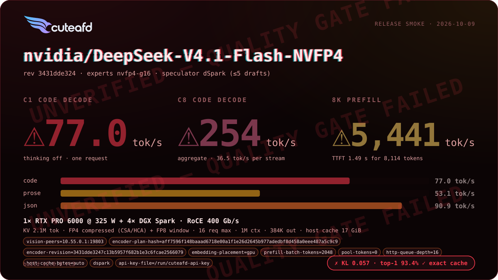
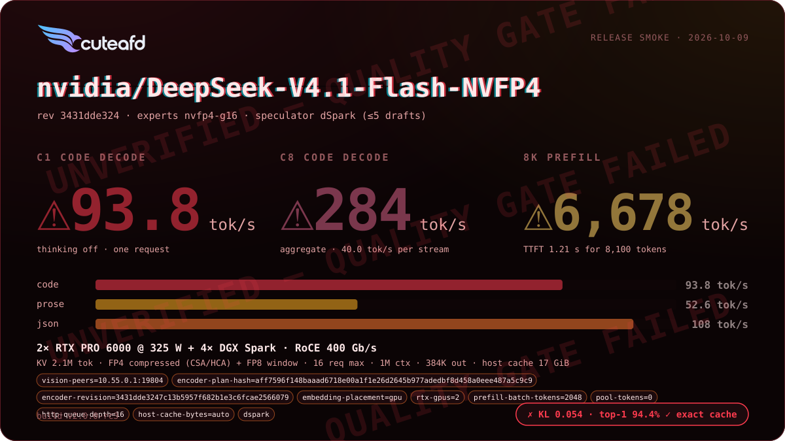

# DeepSeek V4.1 Flash

A core CuteAFD reference family. Releases are checked against this engine's own cards; correctness and memory safety gate, speed regressions are reported.

## Supported checkpoints / quants

- `deepseek-ai/DeepSeek-V4.1-Flash` — official release: FP8 32x32-block
  coordinator weights (E4M3 + UE8M0 scales), native MXFP4 routed experts
  (E2M1 + UE8M0 per 32).
- EXL3 K2–K4 routed-expert quants of the same checkpoint.
- NVIDIA ModelOpt NVFP4 release: native W4A4 routed experts (E2M1 weights
  and activations with E4M3 group-16 scales). The coordinator sends BF16
  hidden rows; Sparks quantize each routed row to FP4 before the MMA.
  **Not recommended**: fails the confident-top-1 fidelity check (see Known
  limits); use the official MXFP4 release.

**Starting configs** (v2.0.0 release cards, natural minimum and maximum; replace the
placeholder Spark hosts and addresses): Official MXFP4 [min](../../examples/configs/deepseek-v41-mxfp4-min.config) · [max](../../examples/configs/deepseek-v41-mxfp4-max.config).

## Engineering summary

- Attention: compressed MLA with a per-layer compression ratio schedule and
  CED (compressed encoder/decoder) KV sharing across index source layers
  `[2, 8, 14, 20]`.
- Engram memory-mapped embedding tables gate layers 1 and 14, read through
  the shared `MappedTable` path (page cache, bounded prefetch, pinned
  upload ring).
- Routed experts run on 2, 3, 4 or 6 Spark ranks over `expertd-native`
  (MXFP4, EXL3 K2–K4, or ModelOpt NVFP4); mHC hyper-connections mix the
  coordinator residual stream.
- Speculator: three-stage dSpark drafter (`markov_head`, `confidence_head`,
  `main_proj`) with adaptive width from a calibrated confidence and cost
  model.
- KV format: compressed MLA latent in FP8 32x32 blocks; a specialized
  exact prefix cache — radix banks keyed by token ids, shared
  FP4 pages, a copied SWA "front", pinned-host tier in `cuteafd-hostcache`.
- RTX/Spark layouts: the v2 native MXFP4 minimum is 1 RTX + 3 Sparks;
  the v2 NVFP4 cards use 4 Sparks. Current MXFP4 and NVFP4 support TP3 as a
  fit-minimum option (see the TP3 decision in `PLAN.md`). The current MXFP4
  maximum is 2 RTX + 6 Sparks; 2 RTX + 4 Sparks is a reference layout.
  V4.1 keeps the coordinator layer-range split by default — the
  measured head-split hop cost on this fabric does not clear the bar its
  attention weights would need to win (see `PLAN.md` Phase 6).
- Vocabulary head: RC1 and RC2 default to `CUTEAFD_V41_FP8_HEAD=all`, one
  shared E4M3 copy for target and dSpark (FP32 scales per row and 128-wide K
  block), partitioned by vocabulary rows on dual RTX. BF16 is released after
  packing. `off` keeps BF16; `draft` retains both formats. Earlier release
  notes incorrectly described BF16 as the default. The matched two-RTX
  v0/RC1 ABAB recheck did not reproduce the historical C1 regression.
- Optional vision tower (MoonViT-style) when the checkpoint carries
  `vision_config`.

## Known limits

- Opt-in `L2_PREFETCH=auto`: Hugh Madden measured +2.4% C1 on a 5090; no clear gain on the RTX PRO 6000. The default remains off.
- Opt-in `ENGRAM_WARM=on` (`serve-native --engram-warm`) reads both Engram tables (about 203 GB for the official checkpoint) once into the page cache on a background thread after readiness, for hosts with RAM for the tables whose checkpoint store has slow random reads. It costs host page cache equal to the table bytes (reclaimable; skipped when available memory is below the tables plus 16 GiB) and background read bandwidth after readiness. The default remains off.

<!-- release-v2-limits -->
- **V4.1 NVFP4 (`nvidia/DeepSeek-V4.1-Flash-NVFP4`): current calibrated W4A4.** Per-expert FC1 calibration replaced the old layer-maximum scale in `268e2ebd`; native W4A4 runs at every row count. [The fidelity policy (#230)](https://github.com/tpurtell/cuteafd/pull/230) treats absolute BF16-root KL/top-1 as informational for this calibrated checkpoint, not a pass/fail bar. The 2026-10-15 cards at `bac064ac` report KL 0.06235 / top-1 93.79% (one RTX + four Sparks) and KL 0.06551 / top-1 93.60% (two RTX + four Sparks); both pass exact cache and lossless speculation. See the [minimum report](../../benchmarks/deepseek_v41/2026-10-15-smoke-deepseek-v4-1-flash-nvfp4-1rtx-4spark-v41-flash-nvfp4-min/report.svg) and [maximum report](../../benchmarks/deepseek_v41/2026-10-15-smoke-deepseek-v4-1-flash-nvfp4-2rtx-4spark-v41-flash-nvfp4-max/report.svg). This is not a claim of BF16 parity or batch invariance.
- **Historical v2 NVFP4 FAIL:** rc3 confident top-1 was 96.7% / 97.1% / 96.5% (one RTX / two RTX / simulated 5090) against the then-required 98%; KL was 0.054-0.057. Those images used layer-maximum FC1 scales, unlike today's per-expert calibration. Their original FAIL cards and v2 recommendation remain historical findings, not a current arithmetic description or a new measurement.
- **Fidelity gate:** historical v2 cards applied the shared floor (KL ≤ 0.06, top-1 ≥ 90%, the reference's own floor) and default tripwires (confident top-1 ≥ 98%, top-3 ≥ 99%). Current calibrated NVFP4 cards report these absolute reference metrics as informational under #230; exact cache and lossless speculation still gate. Other V4.1 formats retain their fidelity gates. PLAN's calibrated V4.1 expectation (top-1 ≥ 94%, KL ≤ 0.04) is a quality target, not a replacement gate.
- **32 GB coordinator (resolved in rc3):** rc2's `v41-flash-sim5090` startup failure (a reconnecting expert session requested 419,495,936 B of Spark rings against a 302,120,960 B budget) is fixed: replaced endpoints release their rings before admission, and V4.1 ring admission is exact per Spark (1,024,851,968 B PRO MXFP4, 1,349,910,528 B PRO NVFP4, 302,120,960 B / 337,575,936 B at 31.8 GiB with 1,024 prefill rows). The rc3 simulated-5090 card passes.
- Cold-prefill non-bit-reproducibility and prefill/decode stalls remain open; prefix snapshot restore exactness does not establish batch-invariant cold prefill.
- A historical small-card host-heap abort was not reproduced or root-caused. The hunt is closed for v2 unless it recurs; MALLOC_CHECK_=3 serving soaks remain required and no memory-safety qualification is claimed. The fixed graph bank addresses graph residency, not the heap cause.
- **TP3 fit-minimum support:** current MXFP4 and NVFP4 runtimes accept TP3; the former native-only TP3 launcher restriction is gone. `PLAN.md` records matched MXFP4 measurements and independent NVFP4 correctness qualification against release TP4. TP3 is not a speed default; TP4 remains default. The historical v2 NVFP4 reference cards use four Sparks and retain their original fidelity findings.

- The FP8 vocabulary head regressed short "hello" replies in its earlier
  comparison. The release C1 recheck covers the two-RTX code workload;
  it does not close the separate short-reply limitation.
- Prompt and turn-end prefix restores are byte-exact against their own
  snapshots. Cold prefill can differ because Spark FP32 atomic expert
  reductions are arrival-ordered at 256+ rows; batch-invariant prefill and
  verify remain deferred.
- Large index-selection and attention-query graph entries can be evicted
  between encoder and replay shapes, so warmed requests can recapture graphs.
- Remote expert layers run on the shared Spark exchange (#717): the router's
  routes and input rows stage from the device, the link's worker builds and
  posts the request, and the reduce waits on the device for the reply.
- NVFP4 uses W4A4 for prefill, decode and speculative verification, with
  per-expert checkpoint `input_scale` calibration for FC1 and FC2. The old
  FC1 layer-maximum substitution is gone; BF16 wire rows preserve the
  expert-specific activation quantization. Smaller wire rows and small-row
  kernel occupancy remain optimization work, not missing calibration support.
- One-RTX startup still waits on slow Spark layer reads after the
  coordinator-first placement handoff; further load-speed work is open.

## Changelog

| Version | Date | Change | Basic eval |
| --- | --- | --- | --- |
| v2 | 2026-10-09 | Spark-rank-0 vision with independent image admission; 2M PRO/1M small-card KV defaults; measured startup/graph admission, host embedding and bounded small-card graphs; unified SM120 launch sizing; rc3: Spark ring release before endpoint replacement and exact V4.1 ring admission (32 GB coordinator starts); NVFP4 scored against the official reference: FAIL, not recommended. |       |
| v3 | 2026-10-18 | Published benchmarks |    |
| v1 | 2026-10-04 | Coordinator-first loading and smaller one-RTX workspaces; opt-in device exchange and default shared single-copy FP8 head; exact turn-end restore check; matched dual-RTX C1 requalification. |     |
| v0 | 2026-10-02 | First release |   |

## Additional benchmarks

| Engine version | Date | Profile | Hardware | Report |
| --- | --- | --- | --- | --- |

_No additional benchmark reports yet._
