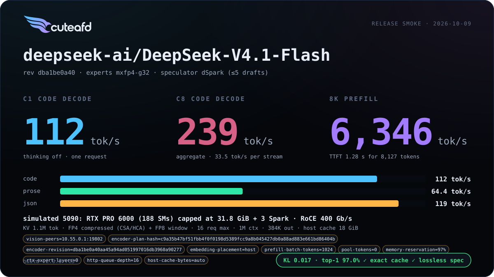
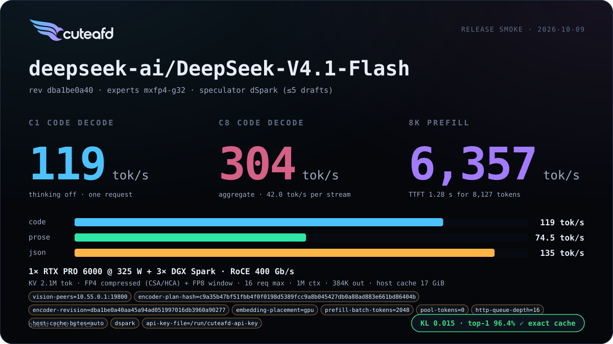
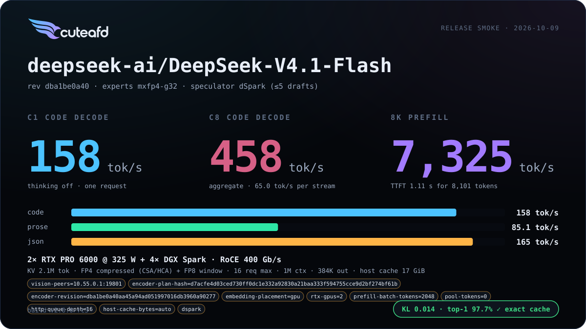
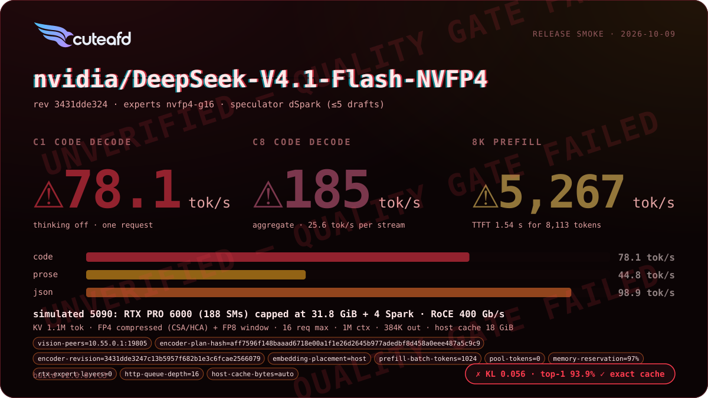
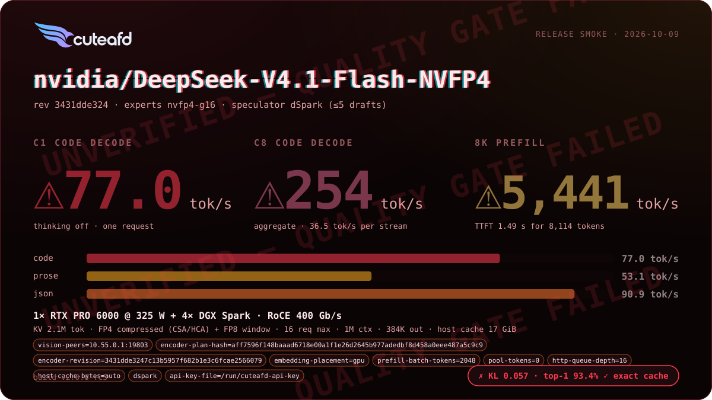
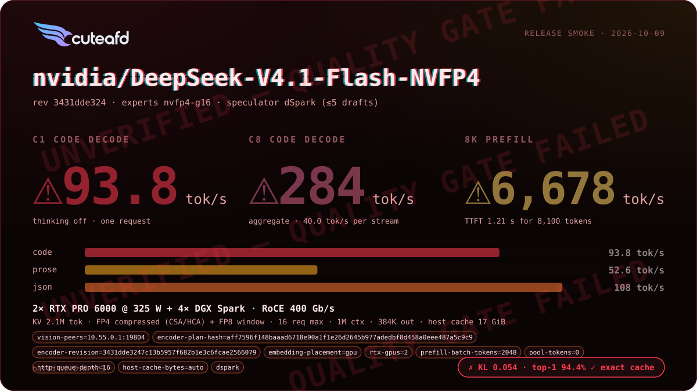
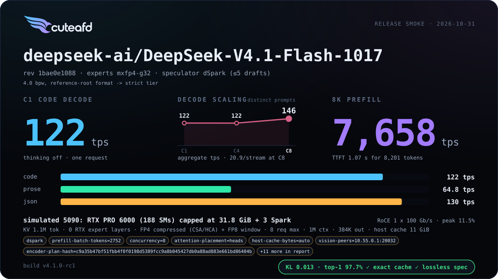
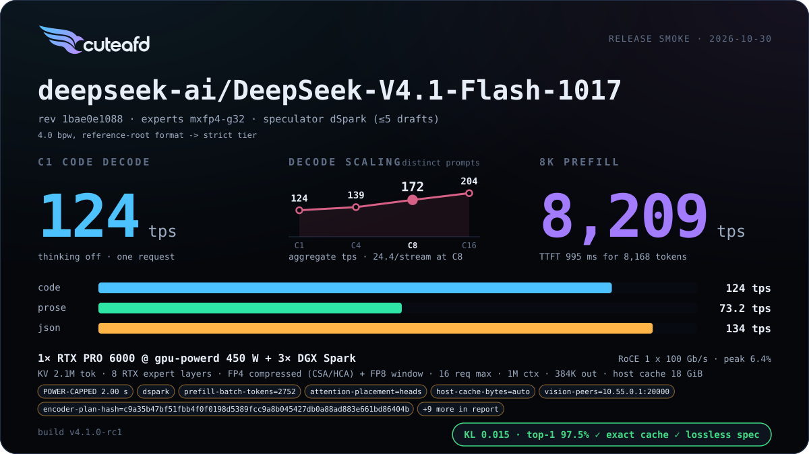
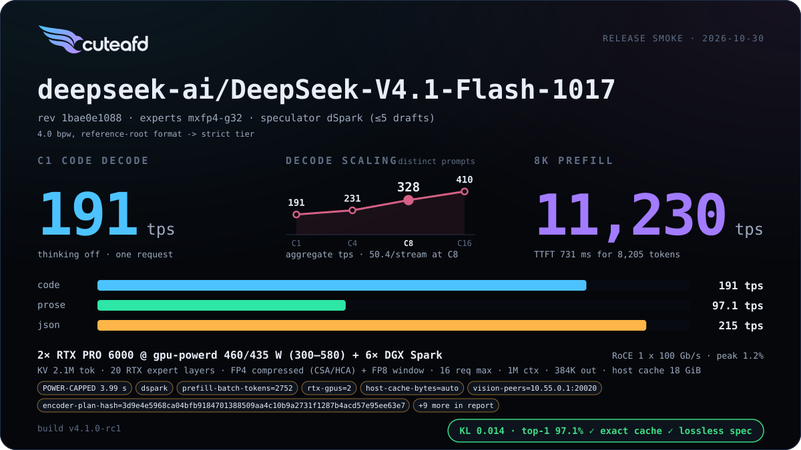
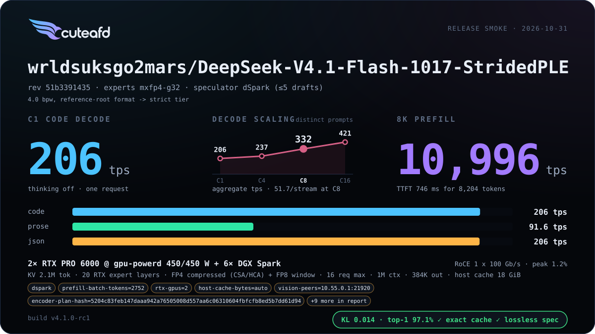

# DeepSeek V4.1 Flash

The v7 release keeps the Strided PLE cards and retires both original
Flash-1017 cards. The original checkpoint, example configs and historical
measurements remain available.

Automatic KV sizing uses the shared 2M-token target on every card, including
32 GB / RTX 5090. Placement and expert onboarding are fixed at that target;
the pool then grows into remaining admitted memory, within native encoding
limits. `KV_MAX_TOKENS` is unset by default and can explicitly cap growth.
See [memory policy](../options.md#memory-and-pools).

A core CuteAFD reference family. Releases are checked against this engine's own cards; correctness and memory safety gate, speed regressions are reported.

## Supported checkpoints / quants

- `deepseek-ai/DeepSeek-V4.1-Flash` — official release: FP8 32x32-block
  coordinator weights (E4M3 + UE8M0 scales), native MXFP4 routed experts
  (E2M1 + UE8M0 per 32).
- EXL3 K2–K4 routed-expert quants of the same checkpoint.
- NVIDIA ModelOpt NVFP4 release: native W4A4 routed experts (E2M1 weights
  and activations with E4M3 group-16 scales). The coordinator sends BF16
  hidden rows; Sparks quantize each routed row to FP4 before the MMA.
  **Not recommended**: fails the confident-top-1 fidelity check (see Known
  limits); use the official MXFP4 release.

**Starting configs** (v2.0.0 release cards, natural minimum and maximum; replace the
placeholder Spark hosts and addresses): Official MXFP4 [min](../../examples/configs/deepseek-v41-mxfp4-min.config) · [max](../../examples/configs/deepseek-v41-mxfp4-max.config).
Release-only limited-bandwidth showcases keep the same max topology and checkpoint:
[FP8/FP8 replies](../../examples/configs/deepseek-v41-mxfp4-max-fp8-reply.config) and
[NVFP4/NVFP4 replies](../../examples/configs/deepseek-v41-mxfp4-max-nvfp4-reply.config)
(prefill/decode). The standard configs keep BF16 replies; development artifacts
omit these optional combined compressed producers and reject explicit selection.
Byte-identical StridedPLE storage: [min](../../examples/configs/v41-flash-strided-min.config) · [max](../../examples/configs/v41-flash-strided-max.config).
Its U8 rows contain 256 FP8 weight bytes followed by eight UE8M0 scale bytes.
Three row-range parts per layer form one shared mapped row space;
`MAPPED_SCALE_PRELOAD_GIB` preloads both complete row tables (all parts, including embedded scales)
only when the full payload fits the cap and available host memory; smaller caps leave them mapped.
There is no separate scale-only preload. `ENGRAM_WARM` warms the whole mapped table.

## Engineering summary

- Attention: compressed MLA with a per-layer compression ratio schedule and
  CED (compressed encoder/decoder) KV sharing across index source layers
  `[2, 8, 14, 20]`.
- Engram memory-mapped embedding tables gate layers 1 and 14, read through
  the shared `MappedTable` path (page cache, bounded prefetch, pinned
  upload ring).
- Routed experts run on 2, 3, 4 or 6 Spark ranks over `expertd-native`
  (MXFP4, EXL3 K2–K4, or ModelOpt NVFP4); mHC hyper-connections mix the
  coordinator residual stream.
- Speculator: three-stage dSpark drafter (`markov_head`, `confidence_head`,
  `main_proj`) with the full native seven-position block. The shared `history`
  policy chooses verified lengths from per-position acceptance history; the
  calibrated head only skips an explore below 0.3. No draft cost model.
- KV format: compressed MLA latent in FP8 32x32 blocks. Prefix cache: the
  shared engine cache (`ReuseRule::V41`: exact ancestors, official bounded
  replay for partial divergence, ranked by rows left to compute; see `PREFIX_PARTIAL`); shared
  FP4 source pages, a mark holding the window rings, odd compressor carry,
  Engram lookback and dSpark rings, snapshots at prompt end and turn end,
  shared `--prefix-cache-*`/`--host-cache-*` flags and pinned-host tier.
- RTX/Spark layouts: the v2 native MXFP4 minimum is 1 RTX + 3 Sparks;
  the v2 NVFP4 cards use 4 Sparks. Current MXFP4 and NVFP4 support TP3 as a
  fit-minimum option (see the TP3 decision in `PLAN.md`). The current MXFP4
  maximum is 2 RTX + 6 Sparks; 2 RTX + 4 Sparks is a reference layout.
  V4.1 keeps the coordinator layer-range split by default — the
  measured head-split hop cost on this fabric does not clear the bar its
  attention weights would need to win (see `PLAN.md` Phase 6).
- Vocabulary head: unset/`V41_FP8_HEAD=auto` selects `packed`, an exact
  12-bit copy of the BF16 target weights; dSpark reads its approximate coarse
  plane. Single RTX, vocabulary-row-split dual RTX and required push loading
  are supported. The transient BF16 source is retired before graphs; one
  target arena per GPU retains the packed planes. Compared with `all`, the
  retained head costs another 300.214 MiB total, or 150.107 MiB per dual-RTX
  GPU. Explicit `all` uses one shared E4M3 copy for target and dSpark (FP32
  scales per row and 128-wide K block); `off` keeps BF16; `draft` retains BF16
  plus E4M3 and remains mounted-load only ([#1572](https://github.com/tpurtell/cuteafd/issues/1572)).
  Earlier releases used `all`, not BF16, as their default. Ordinary memory
  admission decides fit; the packed qualification covers RTX PRO 6000 MXFP4
  min/max, not 5090/32 GB, NVFP4 or StridedPLE performance. Packed does not
  bypass independent expert/projection or StridedPLE+NVFP4 restrictions.
- Decode lanes: unset `DECODE_LANES` resolves by coordinator RTX count at
  `DECODE_ROWS=64` — **1 lane on 1× RTX** (wins C4–C16 and 32K C8 with +20.4%
  KV pool in [#2460](https://github.com/tpurtell/cuteafd/issues/2460#issuecomment-7165698474))
  and **2 lanes on 2× RTX** (keeps the C16 win and 2.28× larger KV pool).
  Explicit `DECODE_LANES=1|2` overrides either layout; `CONCURRENCY=1` always
  resolves to one lane.
- Bundled vision tower (MoonViT-style) when the checkpoint carries
  `vision_config`. `VISION=auto` admits it whenever the KV pool still meets
  `KV_MIN_TOKENS`.

## Settings

| Setting | Default | Scope |
| --- | --- | --- |
| `DECODE_LANES` | `1` on 1× RTX; `2` on 2× RTX (`1` at `CONCURRENCY=1`) | Independent decode lanes at `DECODE_ROWS=64`. Explicit `1` or `2` overrides the layout default; plan, admission and lane-scaled graph reserve follow the resolved count ([#2460](https://github.com/tpurtell/cuteafd/issues/2460#issuecomment-7165698474)). |
| `TP2_DSPARK_EXPERTS` | `on` with two RTX GPUs and dSpark; otherwise `off` | Splits dSpark routed experts across the RTX pair. `off` keeps them on the draft GPU. Explicit `on` requires V4.1, two RTX GPUs and dSpark. |

## Known limits

- Opt-in `L2_PREFETCH=auto`: Hugh Madden measured +2.4% C1 on a 5090; no clear gain on the RTX PRO 6000. The default remains off.
- Opt-in `ENGRAM_WARM=on` (`serve-native --engram-warm`) reads both Engram tables (about 203 GB for the official checkpoint) once into the page cache on a background thread after readiness, for hosts with RAM for the tables whose checkpoint store has slow random reads. It costs host page cache equal to the table bytes (reclaimable; skipped when available memory is below the tables plus 16 GiB) and background read bandwidth after readiness. The default remains off.
- `MAPPED_SCALE_PRELOAD_GIB=N` (`--mapped-scale-preload-gib N`, default 0) preloads the Engram scales (about 6 GiB) when they fit N, and every Engram table, rows and scales (about 189 GiB for the official checkpoint), when all of them fit N and available host memory. The tables then load into host memory before readiness (8 readers, releasing the page cache behind them) and no row is read from storage again; the plan charges them to the host ledger.

<!-- release-v2-limits -->
- **V4.1 NVFP4 (`nvidia/DeepSeek-V4.1-Flash-NVFP4`): current calibrated W4A4.** Per-expert FC1 calibration replaced the old layer-maximum scale in `268e2ebd`; native W4A4 runs at every row count. [The fidelity policy (#230)](https://github.com/tpurtell/cuteafd/pull/230) treats absolute BF16-root KL/top-1 as informational for this calibrated checkpoint, not a pass/fail bar. The 2026-10-15 cards at `bac064ac` report KL 0.06235 / top-1 93.79% (one RTX + four Sparks) and KL 0.06551 / top-1 93.60% (two RTX + four Sparks); both pass exact cache and lossless speculation. See the [minimum report](../../benchmarks/deepseek_v41/2026-10-15-smoke-deepseek-v4-1-flash-nvfp4-1rtx-4spark-v41-flash-nvfp4-min/report.svg) and [maximum report](../../benchmarks/deepseek_v41/2026-10-15-smoke-deepseek-v4-1-flash-nvfp4-2rtx-4spark-v41-flash-nvfp4-max/report.svg). This is not a claim of BF16 parity or batch invariance.
- **Historical v2 NVFP4 FAIL:** confident top-1 was 96.7% / 97.1% / 96.5% (one RTX / two RTX / simulated 5090) against the then-required 98%; KL was 0.054-0.057. Those images used layer-maximum FC1 scales, unlike today's per-expert calibration. Their original FAIL cards and v2 recommendation remain historical findings, not a current arithmetic description or a new measurement.
- **Fidelity gate:** historical v2 cards applied the shared floor (KL ≤ 0.06, top-1 ≥ 90%, the reference's own floor) and default tripwires (confident top-1 ≥ 98%, top-3 ≥ 99%). Current calibrated NVFP4 cards report these absolute reference metrics as informational under #230; exact cache and lossless speculation still gate. Other V4.1 formats retain their fidelity gates. PLAN's calibrated V4.1 expectation (top-1 ≥ 94%, KL ≤ 0.04) is a quality target, not a replacement gate.
- **Historical v2 32 GB coordinator admission:** an earlier build's `v41-flash-sim5090` startup failure (a reconnecting expert session requested 419,495,936 B of Spark rings against a 302,120,960 B budget) is fixed: replaced endpoints release their rings before admission, and V4.1 ring admission is exact per Spark (1,024,851,968 B PRO MXFP4, 1,349,910,528 B PRO NVFP4, 302,120,960 B / 337,575,936 B at 31.8 GiB with 1,024 prefill rows). The v2 simulated-5090 card passes.
- Cold-prefill non-bit-reproducibility and prefill/decode stalls remain open; prefix snapshot restore exactness does not establish batch-invariant cold prefill.
- A historical small-card host-heap abort was not reproduced or root-caused. The hunt is closed for v2 unless it recurs; MALLOC_CHECK_=3 serving soaks remain required and no memory-safety qualification is claimed. The fixed graph bank addresses graph residency, not the heap cause.
- **TP3 fit-minimum support:** current MXFP4 and NVFP4 runtimes accept TP3; the former native-only TP3 launcher restriction is gone. `PLAN.md` records matched MXFP4 measurements and independent NVFP4 correctness qualification against release TP4. TP3 is not a speed default; TP4 remains default. The historical v2 NVFP4 reference cards use four Sparks and retain their original fidelity findings.

- The FP8 vocabulary head regressed short "hello" replies in its earlier
  comparison. The release C1 recheck covers the two-RTX code workload;
  it does not close the separate short-reply limitation.
- Prompt and turn-end prefix restores are byte-exact against their own
  snapshots. Cold prefill can differ because Spark FP32 atomic expert
  reductions are arrival-ordered at 256+ rows; batch-invariant prefill and
  verify remain deferred.
- Large index-selection and attention-query graph entries can be evicted
  between encoder and replay shapes, so warmed requests can recapture graphs.
- Remote expert layers run on the shared Spark exchange (#717): the router's
  routes and input rows stage from the device, the link's worker builds and
  posts the request, and the reduce waits on the device for the reply.
- NVFP4 uses W4A4 for prefill, decode and speculative verification, with
  per-expert checkpoint `input_scale` calibration for FC1 and FC2. The old
  FC1 layer-maximum substitution is gone; BF16 wire rows preserve the
  expert-specific activation quantization. Smaller wire rows and small-row
  kernel occupancy remain optimization work, not missing calibration support.
- One-RTX startup still waits on slow Spark layer reads after the
  coordinator-first placement handoff; further load-speed work is open.

## Changelog

| Version | Date | Change | Basic eval |
| --- | --- | --- | --- |
| dev | 2026-11-08 | Default exact packed target/coarse dSpark vocabulary head; push delivery and TP2 load admission. Same-seal `3515fd45ee` warmed matched code decode, 192 tokens, one launch/arm: min C1/C16 `all` 120.02/464.44 to packed 120.06/462.27 tok/s; max 202.06/916.36 to 202.20/883.98. KL min 0.014390 to 0.014034 (BF16 0.014034), max 0.014316 to 0.013902; no KV pool loss or timed throttling. Max C16 acceptance improves 79.53% to 80.93%, mean accepted draft length 2.825 to 2.830; its 3.53% speed loss is per-step cost, attribution tracked in #1573. | [Qualification and measurements #1571](https://github.com/tpurtell/cuteafd/pull/1571); no release-table refresh. |
| v2 | 2026-10-09 | Spark-rank-0 vision with independent image admission; historical 2M PRO/1M small-card KV defaults (now a uniform 2M target with leftover-memory pool growth); measured startup/graph admission, host embedding and bounded small-card graphs; unified SM120 launch sizing; Spark ring release before endpoint replacement and exact V4.1 ring admission (32 GB coordinator starts); NVFP4 scored against the official reference: FAIL, not recommended. |       |
| v6 | 2026-11-19 | Published benchmarks |     |
| v5 | 2026-11-10 | Published benchmarks |     |
| v4.1 | 2026-10-31 | Engram look-ahead into a bounded row cache with copy-first reads (#916), shared table look-ahead, one-L3 reader pin (#917): 8K prefill 10.3k → 11.2k (max), 7.0k → 8.2k (min). |      |
| v4 | 2026-10-30 | Published benchmarks |      |
| v3 | 2026-10-18 | Published benchmarks |    |
| v1 | 2026-10-04 | Coordinator-first loading and smaller one-RTX workspaces; opt-in device exchange and default shared single-copy FP8 head; exact turn-end restore check; matched dual-RTX C1 requalification. |     |
| v0 | 2026-10-02 | First release |   |

## Additional benchmarks

| Engine version | Date | Profile | Hardware | Report |
| --- | --- | --- | --- | --- |

_No additional benchmark reports yet._
