# GLM 5.3

Ported from `../glmrt`: MLA with a DeepSeek Sparse Attention (DSA) indexer,
a top-8 sigmoid router, and a DFlash2 draft speculator.

## Supported checkpoints / quants

- `zai-org/GLM-5.3` official FP8 — supported, but only fits a small KV pool
  at full size; EXL3 and NVFP4 quants are the recommended way to run the
  full model (see `PLAN.md` quant scope).
- `wrldsuksgo2mars/GLM-5.3-EXL3-K4-v1` and similar EXL3 K4/K5 publications —
  the benchmarked path on both reference configs.
- `wrldsuksgo2mars/GLM-5.3-EXL3-K4-Core-K6` at
  `5a4e83a09a11f3145332ed632d28a9894ea88225` - native MCG K4 routed
  experts and K6 attention, dense/shared FFNs and vocabulary head; qualified
  on 1 RTX PRO 6000 + 4 Sparks and 2 RTX PRO 6000 + 6 Sparks with DFlash2
  ([qualification and receipts](https://github.com/tpurtell/cuteafd/pull/856)).
- NVIDIA ModelOpt NVFP4 (`nvidia/GLM-5.3-NVFP4`) — routed experts in NVFP4
  group-16; dense parts run through the FP8-block/W8A8 paths described
  below.

**Starting configs** (v2.0.0 release cards, natural minimum and maximum; replace the
placeholder Spark hosts and addresses): EXL3 K4 [min](../../examples/configs/glm53-exl3-min.config) · [max](../../examples/configs/glm53-exl3-max.config); NVFP4 [min](../../examples/configs/glm53-nvfp4-min.config) · [max](../../examples/configs/glm53-nvfp4-max.config).

Native EXL3 K4 + K6-core starting configs:
[min](../../examples/configs/glm53-exl3-k6core-min.config) ·
[max](../../examples/configs/glm53-exl3-k6core-max.config).

## Engineering summary

- Attention: MLA with a DSA indexer selecting top-k tokens; pool-gated
  indexer variant shares a previous full layer's selection on shared-indexer
  layers. Dense first layers, then MoE from `first_moe_layer` on.
- Router: sigmoid noaux_tc with `e_score_correction_bias`, routed scale 2.5,
  top-8 of the checkpoint's expert count.
- Routed experts run on Spark TP x EP via `expertd-native`: FP8 128x128
  blocks, EXL3 K4/K5, or ModelOpt NVFP4 (group 16). The solver can also place
  a local RTX TP2 routed prefix through the shared expert backends
  ([P9 qualification](https://github.com/tpurtell/cuteafd/pull/148)); its measured
  qualification is EXL3 K4, not a blanket native NVFP4 hardware claim.
- Speculator: the native MTP layer is not run — DFlash2 external drafters
  are the measured-best speculator for this family, with an adaptive policy
  priced by distinct Spark expert reads.
- Native K6 uses the shared trellis projection contracts, without a BF16
  dense/head shadow. The stored 640-channel `kv_a` output completes its
  native transform before cropping to 576 logical channels. DFlash2 borrows
  the resident K6 target head on its admitted stream; unused K4 MTP weights
  are validated but are not loaded into the routed workers.
- KV format: FP8 MLA latent record (E4M3 + per-128 FP32 group scales, plus
  BF16 RoPE where the layer carries rotary dims); mHC hyper-connections with
  Sinkhorn iterations and an `hc_head` final collapse.
- RTX/Spark layouts: natural minimum is 1 RTX + 4 Sparks with a DFlash2
  drafter; maximum is 2 RTX + 6 Sparks. On two GPUs the projections are
  head-split (`q_b`/`kv_b`/`o_proj`/shared expert, one hidden all-reduce per
  layer) and the attention placement defaults to `context`: each 64-row KV
  page lives once, on GPU `j mod 2`, and decode exchanges the query halves,
  the indexer candidates and the head partials (`ATTENTION_PLACEMENT=heads`
  keeps the replicated latent). Prefill gathers the history into a staging
  view and runs the head-split programs on it, byte-identical to `heads`.
- Prefix cache: page-only state; under `context` each page is stored once
  from its owner, and the pinned host tier is on.

## Default precision (single residency)

Every weight has one resident format. Precision is chosen by measurement:
FP8 converts at load into the only copy where it is faster and the golden
stays within ~0.005 nat KL/NLL; drafters run FP8 whenever emitted tok/s is
higher (they cannot change the output). Measured 2026-10-03, natural minimum,
one warm launch per arm, `CONCURRENCY=4`, code tok/s (C4 aggregate), golden
512 tokens.

| Arm | C1 | C4 | 8K prefill | KL · top-1 · NLL |
| --- | ---: | ---: | ---: | --- |
| checkpoint (BF16 DFlash2) | 41.5 | 63.9 | 2,609 | 0.022 · 90.2% · 3.548 |
| **FP8 DFlash2 (default)** | 43.9 | 71.1 | 2,627 | 0.022 · 90.2% · 3.548 |

GLM 5.3 EXL3 K4, 1 RTX + 4 Sparks. `SPECULATOR_FP8=off` keeps the BF16 drafter.

| Attention configuration | Default | Contract |
| --- | --- | --- |
| `ATTENTION_PLAN_ROWS` / `--attention-plan-rows` | `auto` | Numerical recipe chosen once before admission: loaded drafter width + 1, clamped to 64; without a drafter, 1. Explicit 1..64 overrides it. Serial decode and verification share the recipe; selected scratch covers all 64 execution rows. |

## D-GLM attention qualification

`context` remains the default. Explicit `layers` uses the shared owner-aware
pipeline, whole attention/cache/indexer groups on one GPU, split FFNs and
AfterAttention residual broadcasts. Decode and verify keep one packed step;
ordered prefill currently supports at most two lanes, versus three by default
for `context`. Matched comparisons pin two lanes in both modes; default
three-lane Context 8K prefill is a separate measurement.

The initial 2026-10-15 campaign is **not qualified**: both Layers launches
failed the prefill device-logits return contract after graph warmup, and a
Context launch failed the shared expert-worker CUDA memory query. All three
matched pairs must restart on one fixed sealed candidate, at exactly
2,097,152 pool tokens, two RTX PRO 6000 GPUs and six expert ranks. No placement
speedup or default decision follows from the incomplete arms.

Owned-phase graph calibration from those two launches (78 layers, two TP2
expert layers, 1M context, 213 shapes, 49,416 executables per rank):

| Ready graph bytes | Rank 0 | Rank 1 |
| --- | ---: | ---: |
| Provisional estimate | 8,400,720,000 | 8,400,720,000 |
| Measured capture delta | 5,790,236,672 | 5,762,973,696 |
| Calibrated estimate (117,000 bytes/executable) | 5,781,672,000 | 5,781,672,000 |

The calibrated errors are 8.2 / 17.8 MiB; a separate 10% growth reserve is not
counted at ready. This is an SM120 RTX PRO 6000 measurement, not a 5090 or
arbitrary-shape qualification; new hardware/census and full ready-ledger
agreement require rechecking.

The final Context carry-over check, `ae1c2627` versus sealed K4
`3be01a02`, produced byte-identical saved F32 logits (6,000 x 154,880;
SHA256 `d31225130e056c1237628424d4d2a3cb2f2c1bdaec2bdd106b5d7dbc73dc184b`).
Both used a 2M pool, three prefill lanes and all 78 layers, with routed experts
intentionally skipped to isolate the unchanged coordinator path. NLL was
9.045842721924554 on both; maximum absolute difference and KL were zero.
This is not a routed-expert quality result.

The fresh 2026-10-16 three-session campaign on that same seal is **not
qualified**. All six launches served the exact 2,097,152-token pool; quick
fidelity and `cache_exact` passed in every arm. Layers passed strict lossless
10/10 in all three sessions. Context passed 10/10, then 9/10 (token 109,
0.0054-nat margin), then 5/10. The third Context session also failed baseline
speculation losslessness at token 85/128 with a 0.351-nat margin, while its
repeated drafts-off output and all 128 recorded rows were byte-identical.
Its strict code-5 case diverged at token 89 with a 0.8107-nat margin. These
are correctness failures under investigation, not accepted rounding or
fabric-related speed caveats. Exact retained-prompt replay, fixed verify
widths and a current-base check are required before attribution.

The final Layers census changed to three TP2 expert layers: 49,203
executables per rank over 213 shapes. Predicted ready graph bytes were
5,756,751,000 per rank; measured capture deltas were 5,767,168,000 and
5,739,905,024 bytes, within 10 / 17 MiB. This clears the graph-component
64-MiB bar, not the still-pending full tagged ready-ledger comparison.
Every arm retained an A/B rerun verdict from fabric/residual-traffic caveats;
the third Layers arm additionally failed matched prompt hashes. No speed
or placement-default decision follows. The separate default-three-lane
8K run is held until the correctness investigation is resolved.

The 2026-10-17 attribution follow-up did **not reproduce** the Context
failure. In one queue turn, immutable original seal `3be01a02` ran first,
then rebased K4 head `1bdda27c`; each used its own matching launcher and the
same benchmark client. Both used the original nonce `301102bc7c4af2fa`,
baseline then strict-set then client-sweep order, two prefill lanes, plan
rows 8, exactly 2,097,152 pool tokens, two RTX PRO 6000 GPUs and six expert
ranks. Both passed strict 10/10 with identical generated IDs and raw-logit
row hashes, quick fidelity and `cache_exact` (prompt and turn restores plus
cold recompute). Neither encountered the known Spark admission query OOM.

The current head additionally saved 456 paired full-vocabulary F32
log-probability rows: code-1/2/3/5/6/7, generated offsets 25 through 100,
154,880 entries per row. All pairs were byte-identical; both KL directions,
L2 and maximum absolute difference were zero. Original-seal diagnostics
were trace-only because its immutable server predates row-dump support.
Two independent plain-base full-order checks also passed strict 10/10,
quick fidelity and exact cache restore. These are scoped non-reproductions,
not a proven root cause, evidence that later fixes cured the earlier
failure, or general row/batch invariance. The earlier failures remain part
of the record. Full tagged ready-ledger agreement and a new matched
placement decision remain pending; Context stays the default.

D-GLM is **decided: Context default, Layers explicit** after the 2026-10-17
single matched decision pair on sealed `1bdda27c`. Layers ran first, then
Context, with two lanes, plan rows 8, exactly 2,097,152 pool tokens, two
RTX PRO 6000 GPUs and six expert ranks. Prompt hashes matched. Both passed
quick fidelity, `cache_exact` and strict 10/10 IDs/raw-logit hashes.

`ATTENTION_PLACEMENT=layers` is an explicit opt-in in release and WIP
launches; `auto` still resolves to `context` on a supported two-GPU layout.
The launcher logs the explicit choice, and image/program and memory admission
remain mandatory. Older images without the executor/programs are not enabled
by this launcher change.

| Client measurement | Layers | Context | Layers / Context |
| --- | ---: | ---: | ---: |
| C1 code decode, tok/s | 45.77 | 47.70 | 0.96 |
| C16 code decode, tok/s | 123.46 | 136.00 | 0.91 |
| Cold 8K prefill, tok/s | 1,198.25 | 2,323.74 | 0.52 |
| Cold 8K TTFT, s | 6.713 | 3.462 | 1.94 |

These measurements are **provisional**: both arms retained fabric/foreign
traffic A/B rerun flags, and Layers also reported sequence/retransmit
warnings. They do not establish an accepted speedup or precise regression
magnitude. The default-change bar (C1 at least 1.03, C16 at least 0.98) was
not met; there is no reason to change Context or repeat this campaign.
Default-three-lane Context performance and full ready-memory agreement
are not qualified by this two-lane decision pair.

## Known limits

<!-- release-v2-limits -->
- **Memory vs. kernel support:** checkpoint context and compiled index extent are 1,048,576 tokens. Default effective context is separately bounded by the admitted pool and reported on each card; below 262,144 is a per-cell agentic-floor finding. A memory-fitting layout alone does not qualify a full-length prompt. The 31.8 GiB no-fit cells are separate memory rejections with six Sparks; increasing compiled extent does not remove their byte shortfalls.
- `wrldsuksgo2mars/GLM-5.3-EXL3-K4-v1` does not fit a single 32 GB coordinator even with all six Sparks (planner memory rejection, not a missing kernel); it needs a larger coordinator card or a different checkpoint/placement. Actual rc3 planner at the 31.8 GiB cap with automatic pool: rtx0 full memory layout needs 38219720132 bytes, budget 31997506355 bytes, shortfall 6222213777 bytes. See the linked planner-only 5090 cell; no performance was measured.
- `nvidia/GLM-5.3-NVFP4` does not fit a single 32 GB coordinator even with all six Sparks (planner memory rejection, not a missing kernel); it needs a larger coordinator card or a different checkpoint/placement. Actual rc3 planner at the 31.8 GiB cap with automatic pool: coordinator weights need 52.6 GiB, over the 32 GiB coordinator budget; rtx0 full memory layout needs 54111029708 bytes, budget 31997506355 bytes, shortfall 22113523353 bytes. See the linked planner-only 5090 cell; no performance was measured.

- Official FP8 is outside the v1 release scope: its routed expert weights
  exceed the six-Spark serving budget. EXL3 and NVFP4 cover this family in
  the release matrix.

- A local RTX TP2 expert prefix is supported (P9), but that is not a claim
  that the entire model fits RTX-only; the reference layouts still use Sparks.
- Speculative verify and plain decode, and C1/C4 greedy outputs, can differ.
  The current smoke gate permits verified numerical rounding; it does not
  establish byte-identical speculative output or batch invariance.
  The Core-K6 qualification additionally passed the ten-case strict lossless
  set on the minimum layout: all 128 token IDs and raw-logit row hashes per
  case matched drafts on/off, with real verified/accepted drafts recorded.
  Both layouts passed exact prompt/turn cache restores and quick fidelity
  against the official BF16 root. These scoped checks are not a general
  row/batch-invariance or full-context qualification.
- Prefill remains Spark-bound at both reference layouts; additional RTX
  head-split capacity does not remove the expert-wave bottleneck.
- Declared NVFP4 routed experts use native W4A4 at every row count, including
  decode and verify, with per-expert checkpoint calibration and BF16 Spark
  ingress. The W4A16 serving fallback and intermediate FP8 wire quantization
  were removed ([checkpoint-numerics change](https://github.com/tpurtell/cuteafd/commit/a69d81625c86119a2c239ac0c888d33e5c3010a1)).
  Gate/up input scales must agree for the fused activation quantization;
  small-row throughput tuning remains separate from arithmetic support.

## Changelog

| Version | Date | Change | Basic eval |
| --- | --- | --- | --- |
| v2 | 2026-10-09 | Thinking-off template correction; exact full-logits fidelity workspace admission; runtime-sized SM120 launches and robust GPU/RDMA selection; shared C8 and fidelity tiers. | <a href="../../benchmarks/glm5/2026-10-09-smoke-glm53-exl3-no-fit-rc3-sim5090/report.svg">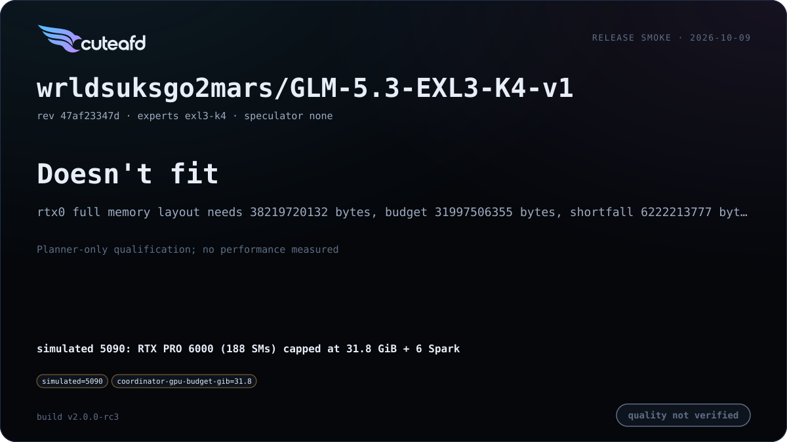</a> <a href="../../benchmarks/glm5/2026-10-09-smoke-glm-5-3-exl3-k4-v1-1rtx-4spark-glm53-exl3-min-rc3/report.svg">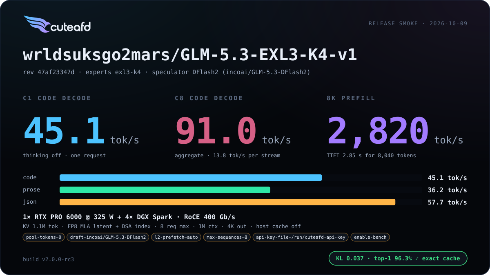</a> <a href="../../benchmarks/glm5/2026-10-09-smoke-glm-5-3-exl3-k4-v1-2rtx-6spark-glm53-exl3-max-rc3/report.svg">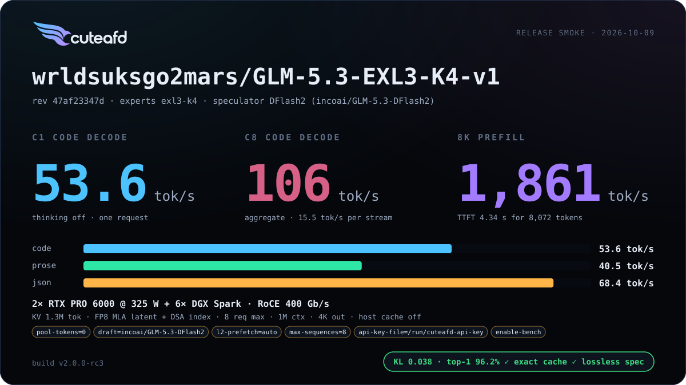</a> <a href="../../benchmarks/glm5/2026-10-09-smoke-glm53-nvfp4-no-fit-rc3-sim5090/report.svg">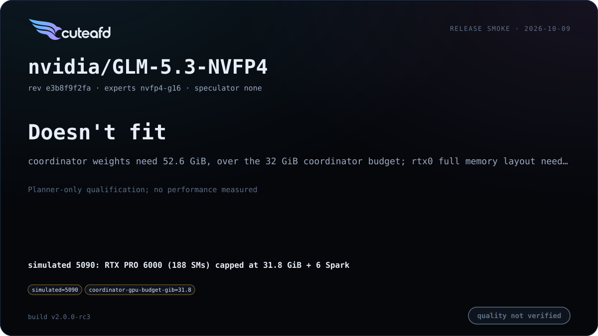</a> <a href="../../benchmarks/glm5/2026-10-09-smoke-glm-5-3-nvfp4-1rtx-4spark-glm53-nvfp4-min-rc3/report.svg">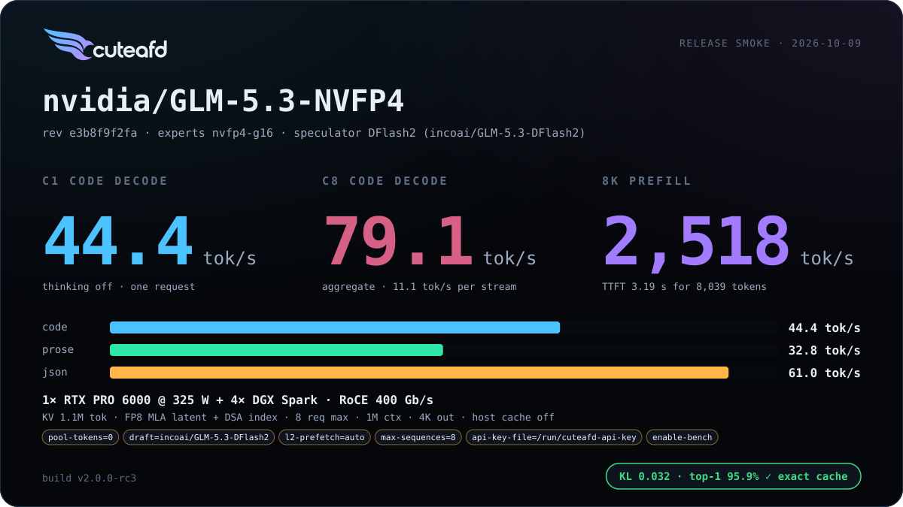</a> <a href="../../benchmarks/glm5/2026-10-09-smoke-glm-5-3-nvfp4-2rtx-6spark-glm53-nvfp4-max-rc3/report.svg">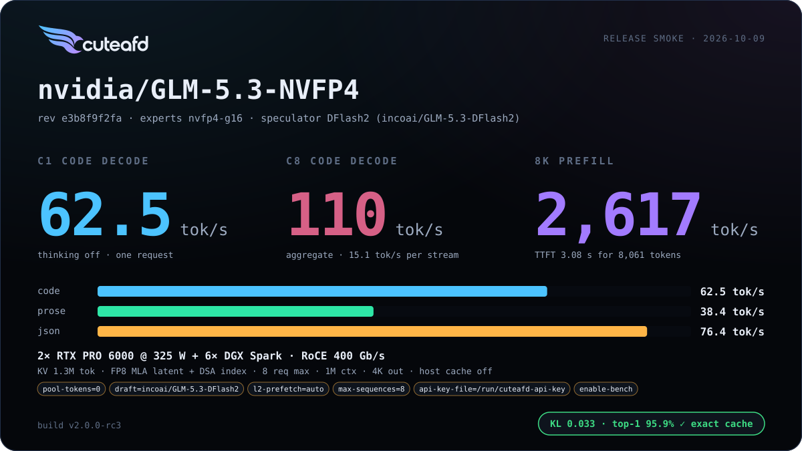</a> |
| v4.1 | 2026-10-31 | Spark EXL3 FC1 rotation in-tile on DGX Spark (#913, fixes #912): max 8K prefill 2.6k → 3.5k. |  <a href="../../benchmarks/glm5/2026-10-31-smoke-glm-5-3-exl3-k4-v1-2rtx-6spark-glm53-exl3-max/report.svg">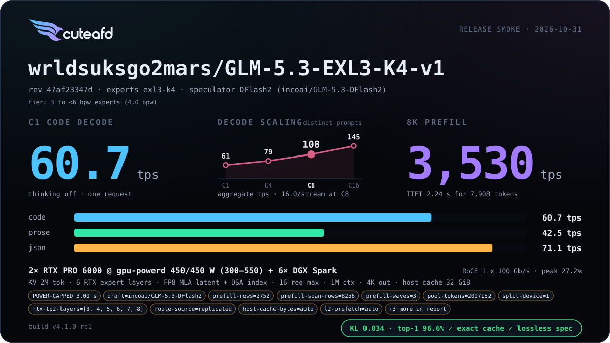</a> <a href="../../benchmarks/glm5/2026-10-30-smoke-glm-5-3-exl3-k4-core-k6-1rtx-4spark-glm53-exl3-k6core-min/report.svg">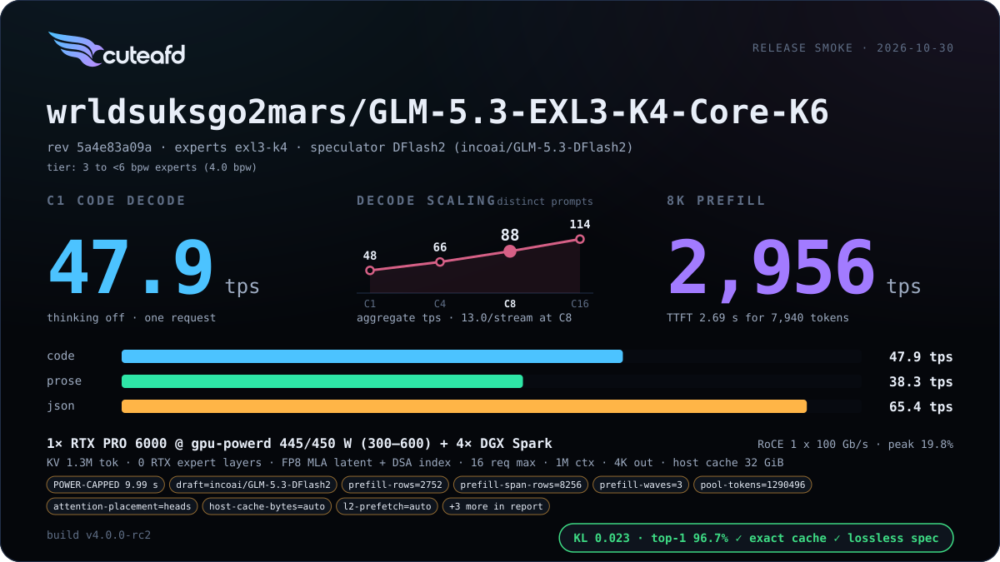</a> <a href="../../benchmarks/glm5/2026-10-31-smoke-glm-5-3-exl3-k4-core-k6-2rtx-6spark-glm53-exl3-k6core-max/report.svg">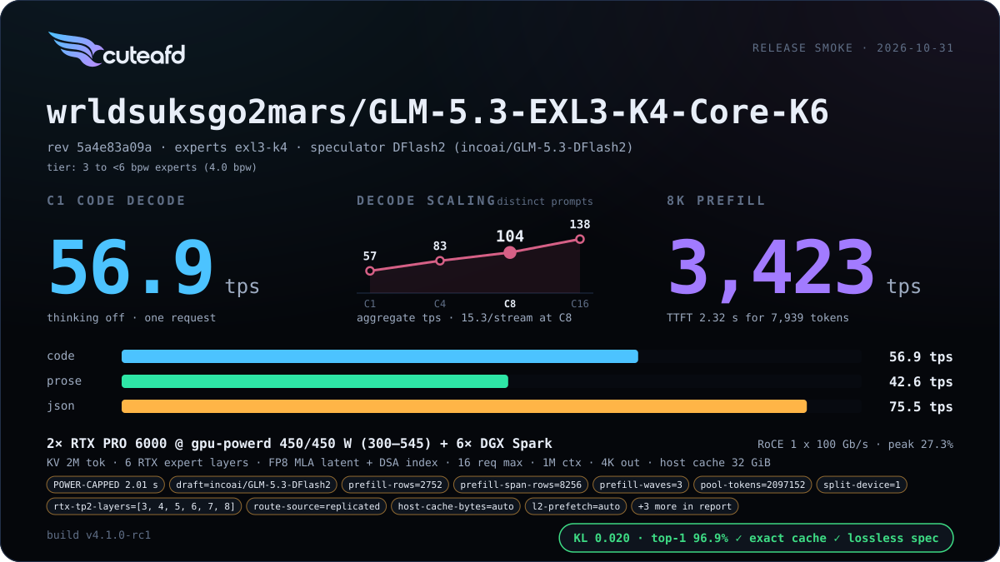</a> <a href="../../benchmarks/glm5/2026-10-30-smoke-glm-5-3-nvfp4-1rtx-4spark-glm53-nvfp4-min/report.svg">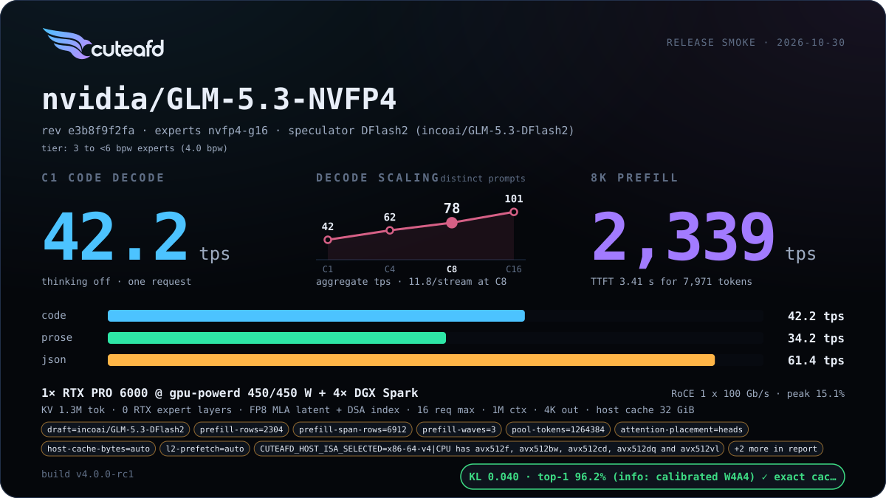</a> <a href="../../benchmarks/glm5/2026-10-30-smoke-glm-5-3-exlr8-k2-k3-k4-1rtx-4spark-glm53-exlr8-min/report.svg">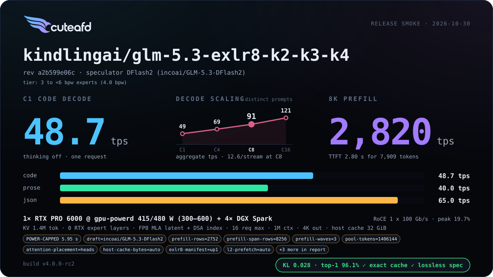</a>  |
| v4 | 2026-10-30 | Published benchmarks | <a href="../../benchmarks/glm5/2026-10-30-smoke-glm-5-3-exl3-k4-v1-1rtx-4spark-glm53-exl3-min/report.svg">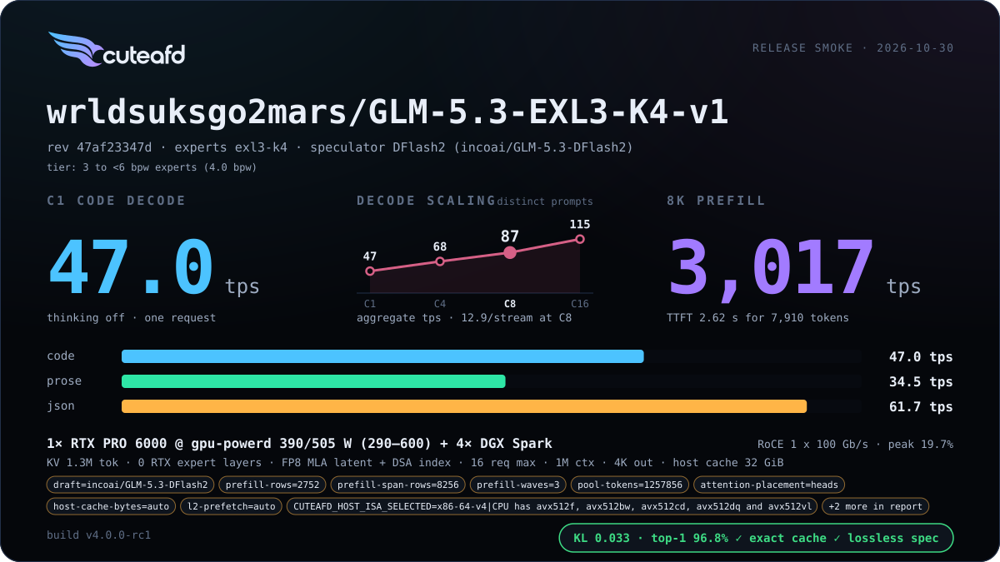</a> <a href="../../benchmarks/glm5/2026-10-30-smoke-glm-5-3-exl3-k4-v1-2rtx-6spark-glm53-exl3-max/report.svg">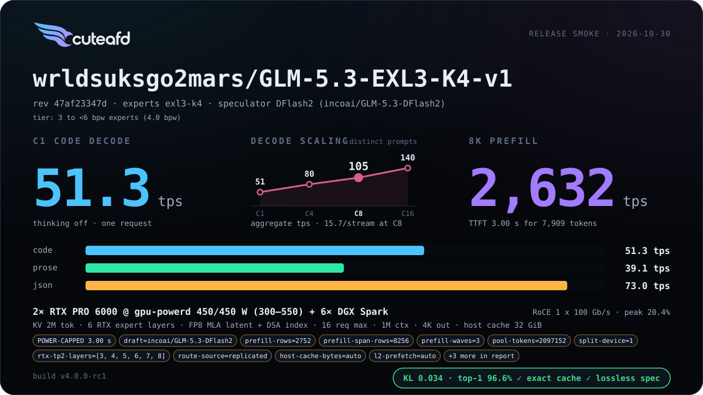</a>  <a href="../../benchmarks/glm5/2026-10-30-smoke-glm-5-3-exl3-k4-core-k6-2rtx-6spark-glm53-exl3-k6core-max/report.svg">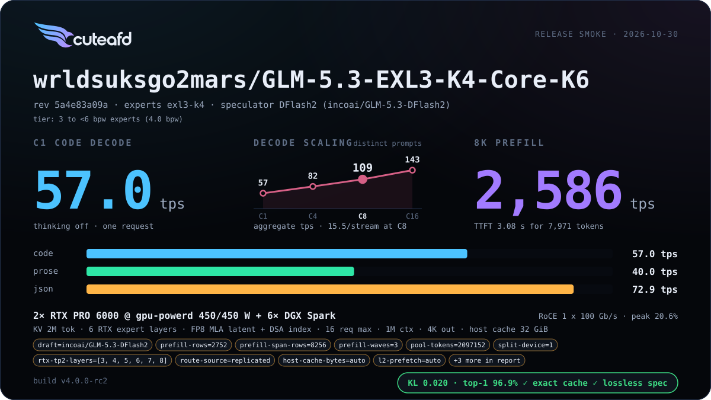</a>    |
| v3 | 2026-10-18 | Published benchmarks |   |
| v1 | 2026-10-04 | E4M3 MLA prefill, Spark EXL3 wave scheduling and TP6 tiles; bounded decode graphs and automatic KV pool; FP8 DFlash2; stop-token grammar completion. |     |
| v0 | 2026-10-02 | First release |     |

## Additional benchmarks

| Engine version | Date | Profile | Hardware | Report |
| --- | --- | --- | --- | --- |

_No additional benchmark reports yet._
