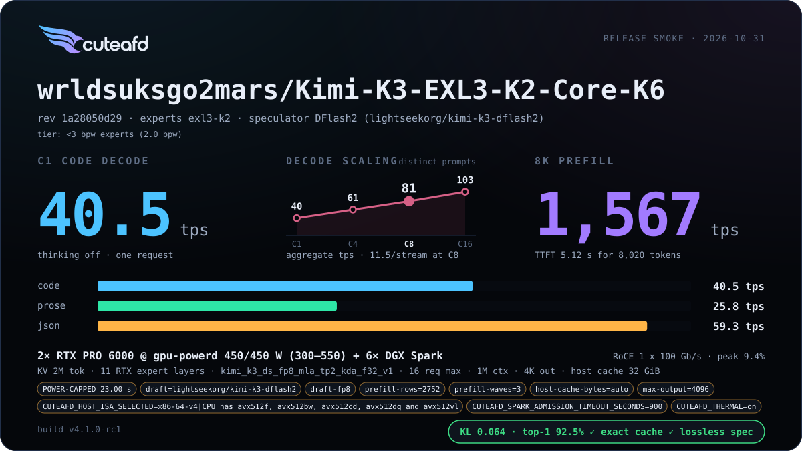

# Kimi K3

`wrldsuksgo2mars/Kimi-K3-EXL3-K2-Core-K6` serves on two RTX PRO 6000 GPUs plus
six Sparks: EXL3 K2 routed experts on the Sparks (with RTX onboarding), and a
native K6 dense core (attention, dense and shared FFN, vocabulary head) on the
RTX cards. Drafts come from DFlash2. Kimi K3 has no MTP.

Starting config (replace the REPLACE-ME Spark hosts and the 192.0.2.x RoCE
addresses): [max](../../examples/configs/kimi-k3-exl3-k6-max.config).

## Release card

