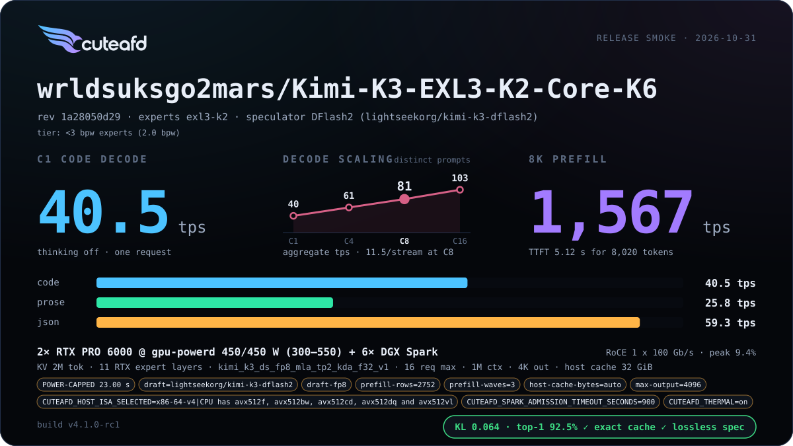

# Kimi K3

The v7 card set keeps K3 Core-K6 on 2 RTX + 6 Sparks. K3.1 MC uses K8
compact on both its one- and two-RTX cards (6 Sparks each). The
v7 drops the original, K6 compact and FP8 compact comparison (TJ 2026-11-28); its last cards stay pinned in the [comparison matrix](../../scripts/bench/release-smoke-v7-mc-compact.json)'s retired list.

Automatic KV sizing uses the shared 2M-token target on every card, including
32 GB / RTX 5090. Placement and expert onboarding are fixed at that target;
the pool then grows into remaining admitted memory, within native encoding
limits. `KV_MAX_TOKENS` is unset by default and can explicitly cap growth.
See [memory policy](../options.md#memory-and-pools).

`wrldsuksgo2mars/Kimi-K3-EXL3-K2-Core-K6` serves on two RTX PRO 6000 GPUs plus
six Sparks: EXL3 K2 routed experts on the Sparks (with RTX onboarding), and a
native K6 dense core (attention, dense and shared FFN, vocabulary head) on the
RTX cards. Drafts come from DFlash2. Kimi K3 has no MTP.

On an active two-RTX split with DFlash2, `TP2_DFLASH=on` is the default:
the draft cache and attention are split by Context across both GPUs, while
producer weights and FFN stay on GPU1. This balances memory and compute;
the [qualification card](https://github.com/tpurtell/cuteafd/pull/1371)
reduced the per-GPU memory gap from 3.83 to 2.38 GiB with effectively tied
decode throughput. Larger KV pools can use the freed GPU1 headroom.
Set `TP2_DFLASH=off` to keep the draft on GPU1; direct CLI users can pass
`--tp2-dflash false`. Single-GPU or non-DFlash2 configurations default off.

Starting config (replace the REPLACE-ME Spark hosts and the 192.0.2.x RoCE
addresses): [max](../../examples/configs/kimi-k3-exl3-k6-max.config).

## Kimi K3.1 Pro

[Max starting config](../../examples/configs/kimi-k31-exl3-k2-mc-max.config):
MC original BF16 core, 2 RTX + 6 Sparks, automatic pool/context/onboarding,
automatic native DSpark. `CORE_VIEW=k6-compact` and the standalone native Core-K6
checkpoint are also supported. MC revision `1455b31b` corrects compact-view
metadata (unchanged weight shards); older `d6c4b6ce` compact views refuse (#2118).
K8 compact uses the same runtime admission; fidelity does not gate serving.
Whole-core FP8 refuses only unsupported tensor roles with the missing route.
K3 DFlash2 hidden-state compatibility remains independently unqualified.
Inferact block dSpark integration is tracked in #2261: native BF16 weights,
checkpoint-derived 2,048-token GQA window, rank-512 Markov confidence, shared
policy/executor and target embedding/head. Unset/`auto` `SPECULATOR` selects DSpark
for K3.1 targets with a content-paired native drafter, across supported MC views,
KV formats and layouts, subject to structural and memory admission. `SPECULATOR_FP8=auto` selects FP8 projection weights and
`DRAFT_KV_CACHE=fp8` stores the independent drafter rings. Explicit
`SPECULATOR=off` wins; weight and ring precision overrides remain independent.
Drafter pairing checks its declared verifier architecture and geometry against
the target metadata, not frozen measured snapshot SHA-256 digests, repository
names, paths, view names or Spark counts. Unsupported whole-core FP8 target roles
still refuse before loading with the missing kernel/tensor contract. Cold and
full-prompt warm strict sets passed 10/10 on both TP2 core views; TP1 K6 has its
own gate. FP8 weights save 1.227 GB net per GPU after scratch. Sustained C8/C16
results, not closed-batch drain tails, select the default arm (#2261).
The sampled Inferact 4.16 reference uses a different draft-sampling/rejection
method and is not directly comparable (#2312). TP1 runs on one RTX; TP2 splits 96 query/16 KV heads to
48/8 per rank and splits FFN neurons, with private exchange flags and local
per-rank prefix marks. FC/norms are replicated, Markov/confidence on the head.
`DRAFT_KV_CACHE` selects FP8 (default) or BF16 independently of target KV and drafter weights.
One-RTX K6 fit depends on pool/context and Spark capacity: the matched
766,784-token pool at the measured post-reboot Spark capacity fits the
Inferact drafter with two onboarded layers. The default 108 GiB Spark budget
can refuse this configuration; #2082 tracks measured-cap admission.

Full-model BF16/K6 fidelity is accepted. TJ accepted partial paired scoring
coverage explicitly: Layers 26 decode windows and Context 51 windows
(36 decode, 15 prefill), all full-vocabulary F32 rows and committed KDA/MLA/index
states exact, zero mismatches, with matching Serve/Golden admission. This is
77 exact windows, not a completed 72+72-window proof (#1777/#2128).

`VISION=auto` keeps the bundled still tower when the KV pool can still meet
`KV_MIN_TOKENS`; use `VISION=off` for text-only serving.

## Core views

The old Kimi K3 `-HQA` checkpoint was withdrawn from Hugging Face.

`wrldsuksgo2mars/Kimi-K3.1-Pro-EXL3-K2-MC` uses the [MC contract](../mc-checkpoints.md).
`CORE_VIEW=original` retains the complete source-native BF16 core, not a mixture
of native attention outputs and trellis inputs. `k8-compact` and `k6-compact`
select complete trellis cores. Direct CLI uses `--core-view VALUE`.
The selected metadata, memory ownership, worker identity and graph prewarm key
remain fixed for the model lifetime. Untraced views use unpinned bootstrap
shapes, never another view's measured graph inventory.

`fp8-compact` refuses for this MC original; whole-core FP8 is pending.

## Release card

## Changelog

| Version | Date | Change | Basic eval |
| --- | --- | --- | --- |
| v5 | 2026-11-10 | Published benchmarks |  |
| v6 | 2026-11-19 | Published benchmarks |    |
