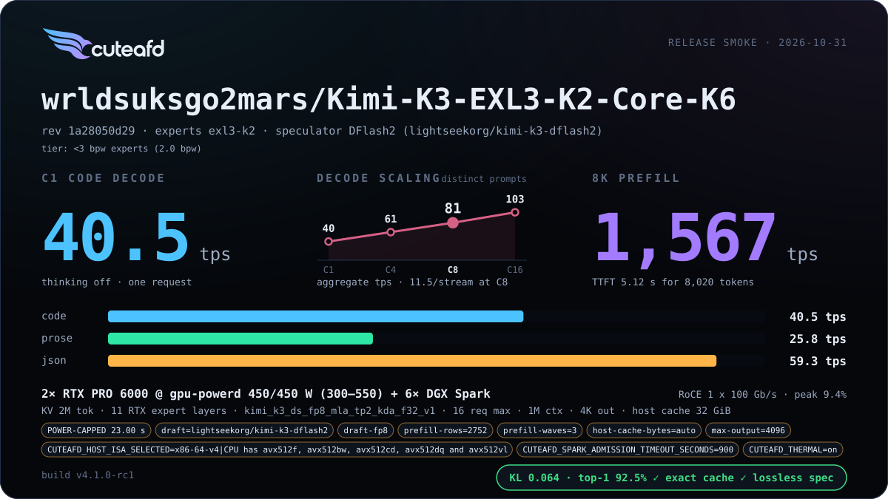

# Kimi K3

`wrldsuksgo2mars/Kimi-K3-EXL3-K2-Core-K6` serves on two RTX PRO 6000 GPUs plus
six Sparks: EXL3 K2 routed experts on the Sparks (with RTX onboarding), and a
native K6 dense core (attention, dense and shared FFN, vocabulary head) on the
RTX cards. Drafts come from DFlash2. Kimi K3 has no MTP.

On an active two-RTX split with DFlash2, `TP2_DFLASH=on` is the default:
the draft cache and attention are split by Context across both GPUs, while
producer weights and FFN stay on GPU1. This balances memory and compute;
the [qualification card](https://github.com/tpurtell/cuteafd/pull/1371)
reduced the per-GPU memory gap from 3.83 to 2.38 GiB with effectively tied
decode throughput. Larger KV pools can use the freed GPU1 headroom.
Set `TP2_DFLASH=off` to keep the draft on GPU1; direct CLI users can pass
`--tp2-dflash false`. Single-GPU or non-DFlash2 configurations default off.

Starting config (replace the REPLACE-ME Spark hosts and the 192.0.2.x RoCE
addresses): [max](../../examples/configs/kimi-k3-exl3-k6-max.config).

## Attention and core views

The `-HQA` checkpoints are withdrawn from Hugging Face. They're being replaced by multi-core (MC) checkpoints that bundle the original dense core with selectable K8 and K6 cores. Until those publish, serve the Core-K6 checkpoint above.

## Release card

## Changelog

| Version | Date | Change | Basic eval |
| --- | --- | --- | --- |
| v5 | 2026-11-10 | Published benchmarks |   |
