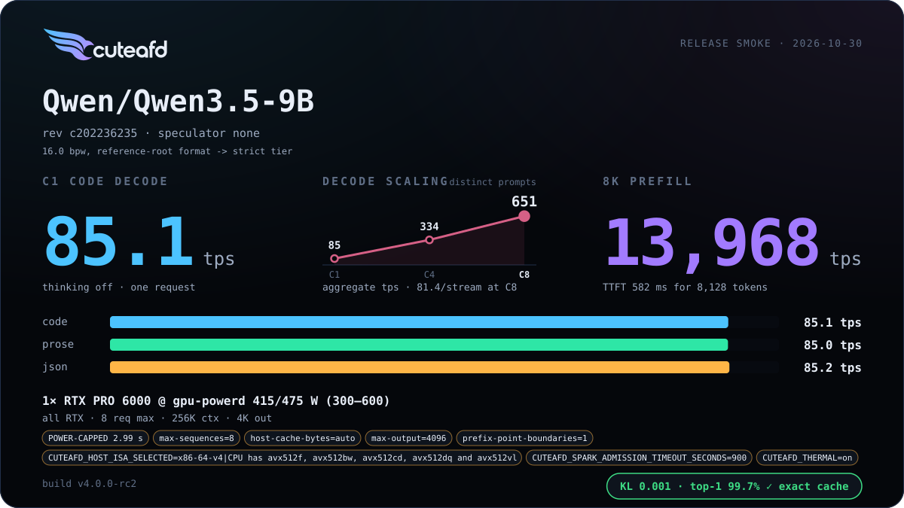
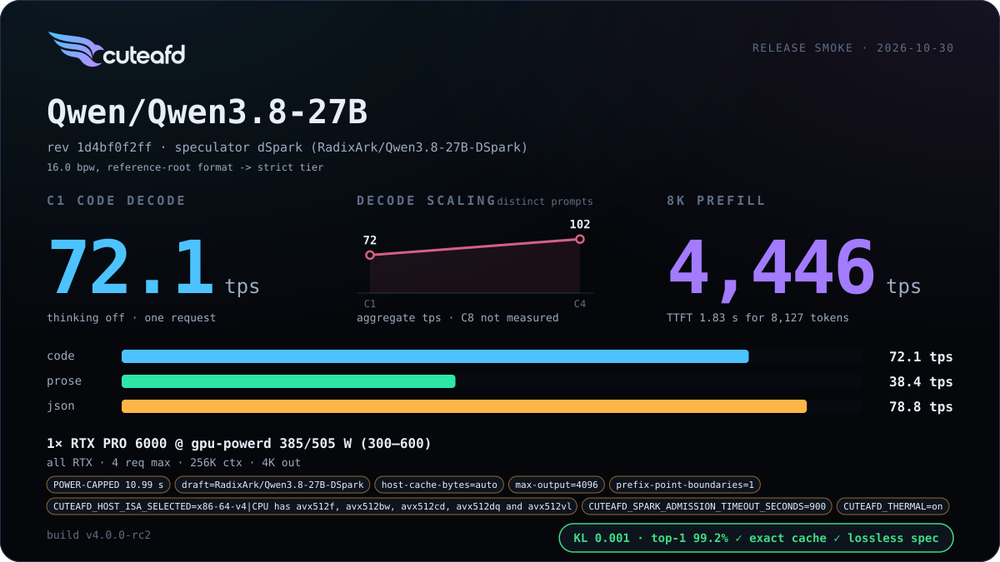
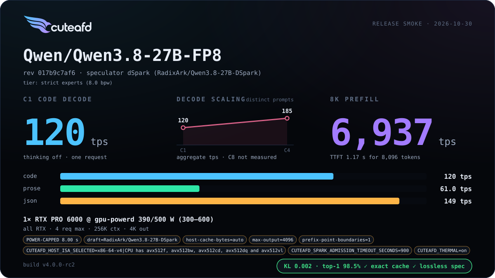

# Dense Qwen 3.5 / 3.8

Dense Qwen checkpoints serve on one RTX PRO 6000 from their own Hugging Face
headers: `Qwen/Qwen3.5-9B` (BF16), and `Qwen/Qwen3.8-27B` in BF16 and FP8.
With no routed experts there is nothing to place on Sparks, so these layouts use
no Sparks. A two-RTX layout (`RTX_GPUS=2`, `COORDINATOR_GPUS=0,1`,
`ATTENTION_PLACEMENT=auto` or `layers`) uses solver-selected contiguous whole-layer
owners and shared residual hops. Each rank owns one native weight arena and its
own KV/GDN, exact prefix marks and decode graph bank. The embedding, head and
drafter stay on the primary rank. Graphs capture rank-local layers; hops remain
eager and single-rank prewarm/pins are not reused. The split buys memory capacity,
not simultaneous computation of a layer. Head/context sharding is an unbuilt
native-export feature tracked in #2133; it never silently becomes layer ownership.
Qwen 3.8 27B drafts with dSpark; Qwen 3.5 9B runs without a drafter.
A dense card admits 4 concurrent requests (8 for the 9B), so its widest
concurrency point is that limit.

Starting configs: [Qwen 3.5 9B BF16](../../examples/configs/qwen35-9b-bf16-min.config) ·
[Qwen 3.8 27B BF16](../../examples/configs/qwen38-27b-bf16-min.config) ·
[Qwen 3.8 27B FP8](../../examples/configs/qwen38-27b-fp8-min.config).

## Release cards

## Changelog

| Version | Date | Change | Basic eval |
| --- | --- | --- | --- |
| v5 | 2026-11-10 | Published benchmarks |    |
